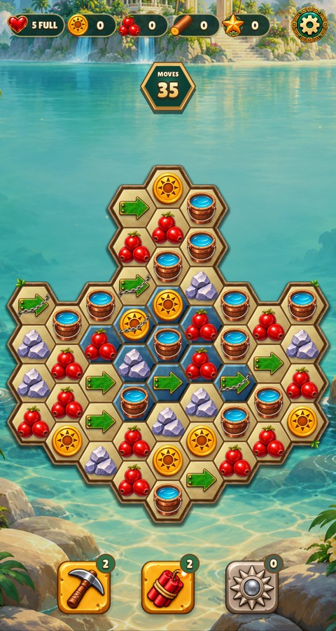
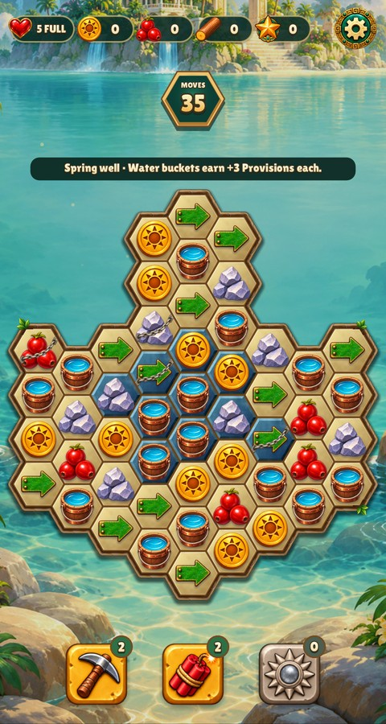
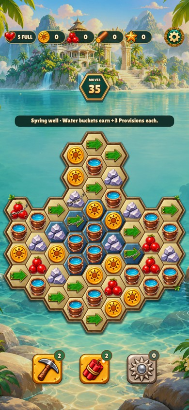
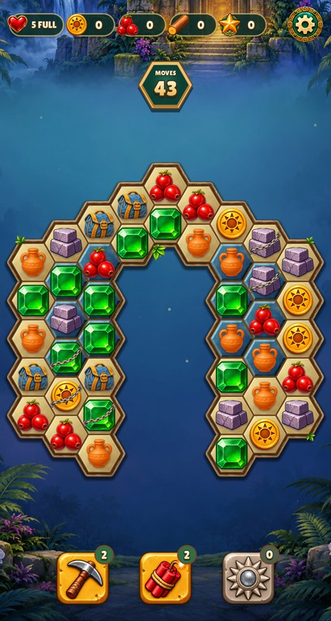
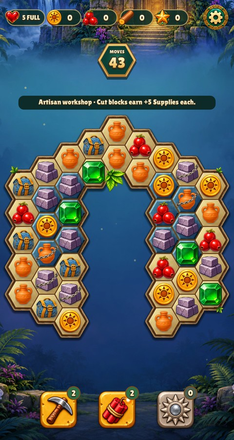
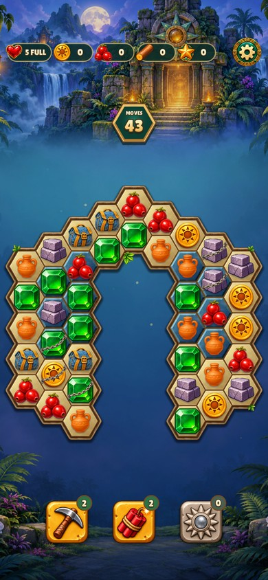
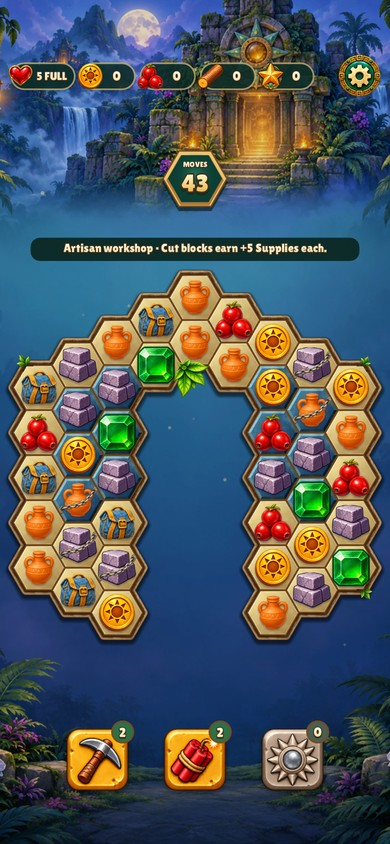
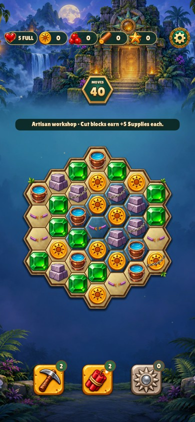
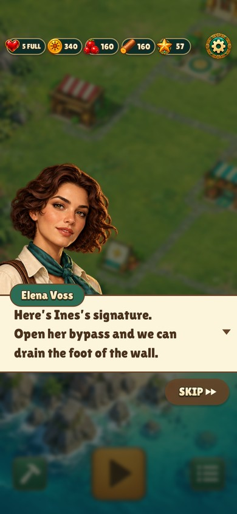

# Relic Rush harbor campaign

The Spring Well credits 3 Provisions per bucket from level 5. The Artisan
Workshop credits 5 Supplies per cut block from level 8. On levels 5 and 9 the
first idle hint matches three of the new pieces and clears three plaques.

| Board and size | Previous opening | Harbor campaign |
| --- | --- | --- |
| Well, 480 × 900 |  |  |
| Well, 390 × 844 |  |  |
| Workshop, 480 × 900 |  |  |
| Workshop, 390 × 844 |  |  |

| Level 8 | Opening dialogue | Level 20 |
| --- | --- | --- |
|  |  |  |

Reproduce the new captures with `build/test/relic-rush "shot harbor-"`. The
previous openings use the `water-after`, `plaques-phone`, `floating-hud` and
`phone-floating-hud` captures from before the campaign change.
