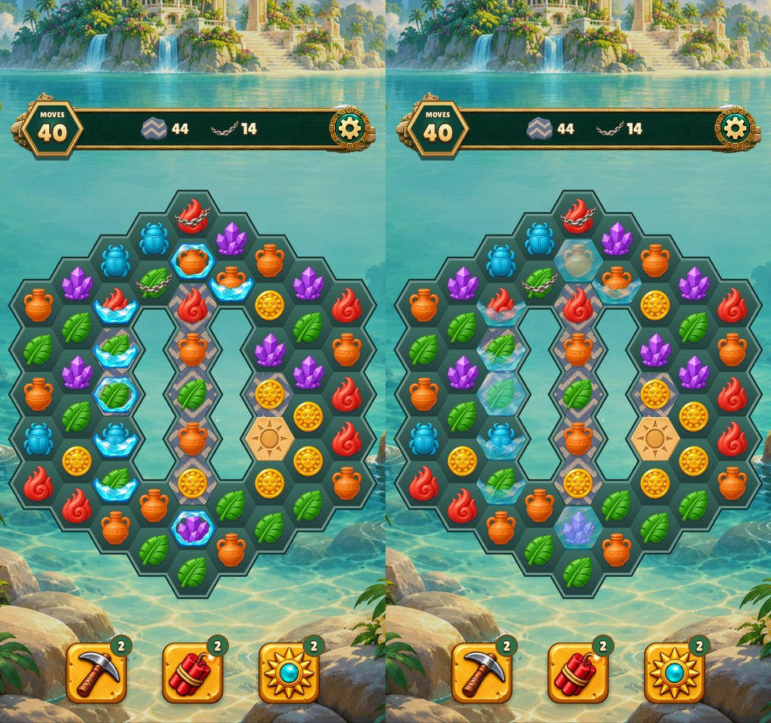
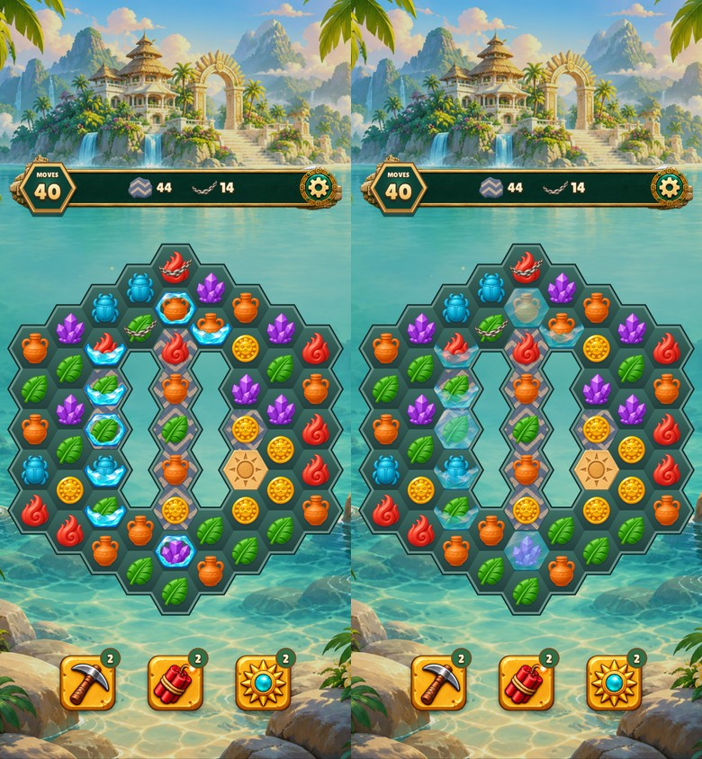
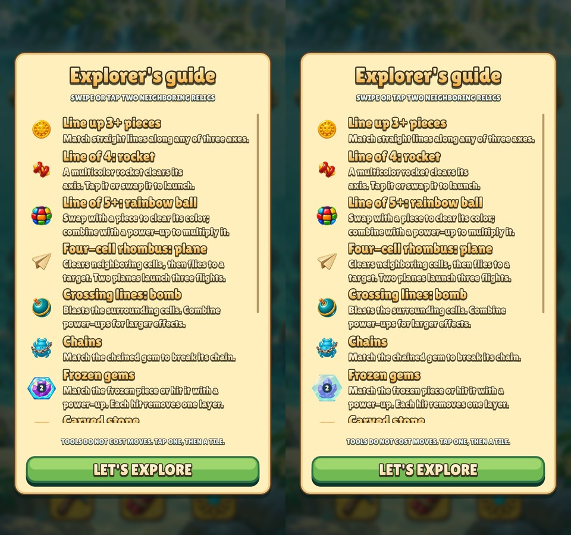
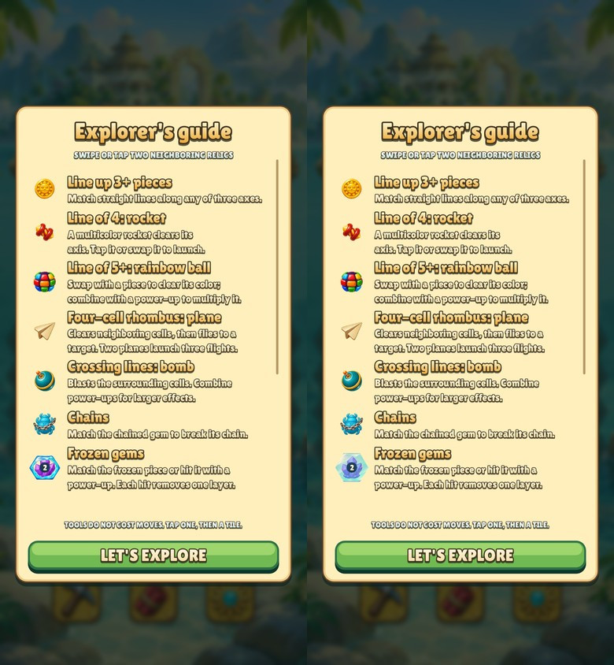

# Relic Rush ice review

The Frozen Stair (level 22) shows both hit strengths. The Explorer's Guide
shows the full pane with its hit count. Each pair shows the earlier open-shell
artwork on the left and the translucent, mask-fitted ice on the right.

| Screen | 480×900 | 390×844 |
| --- | --- | --- |
| The Frozen Stair |  |  |
| Explorer's Guide |  |  |

The Jewels and Resources packs and the default engine skin were checked using
`art-jewels`, `art-resources` and `resource-icons-default-480x900`.
