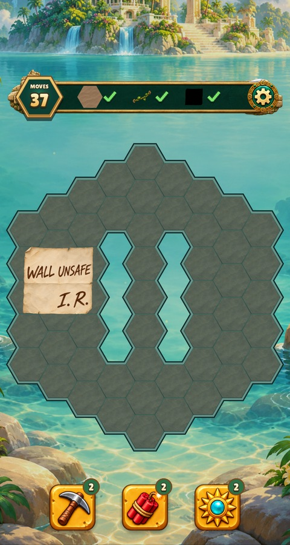
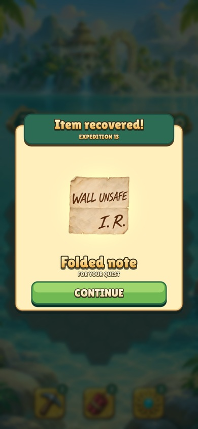
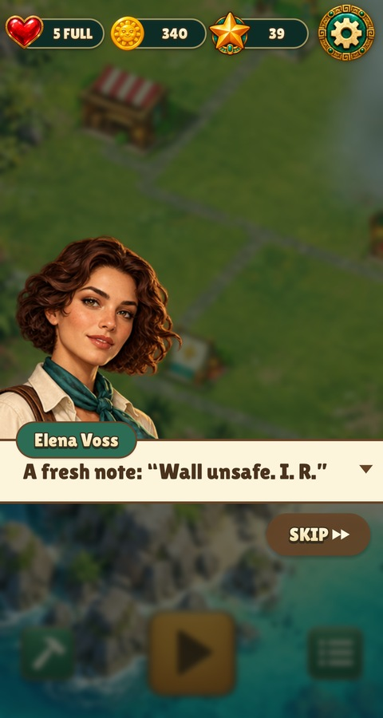
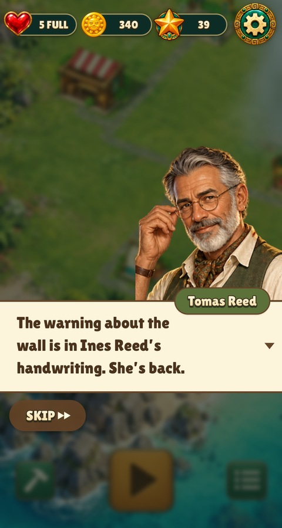

# Board 13 warning note

Seven cells of dig sand hide the note in the left lane. Clearing a cell reveals
its part of the paper. The board also asks players to sweep the drifting sand
and clear the vines. Both lanes and the connecting spine start with swept stone
so players can spread the swept area on either side. The move budget is 37.

| Phone viewport | Before | Buried note |
| --- | --- | --- |
| 480×900 |  |  |
| 390×844 |  |  |

| 480×900 partial excavation | 480×900 first clear | 390×844 recovered-item card |
| --- | --- | --- |
|  |  |  |

[Recovered-item card at 480×900](award-480x900.jpg)

Elena reads the note while the courtyard still needs work. Once the player
confirms the courtyard’s restoration, Tomas identifies Ines.

| First-clear dialogue preview | Courtyard dialogue preview |
| --- | --- |
|  |  |

```sh
SPRITE_SCENARIO=1 build/test/relic-rush 'frame scenario-relic-rush-board-13' 'frame scenario-relic-rush-find-13' 'shot note-'
python3 tools/scenario_overview.py
```
