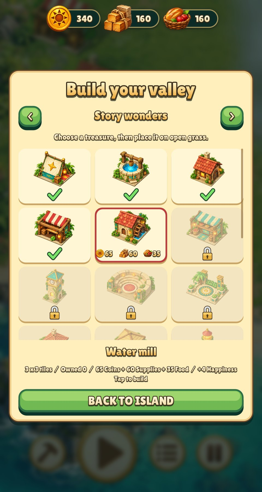
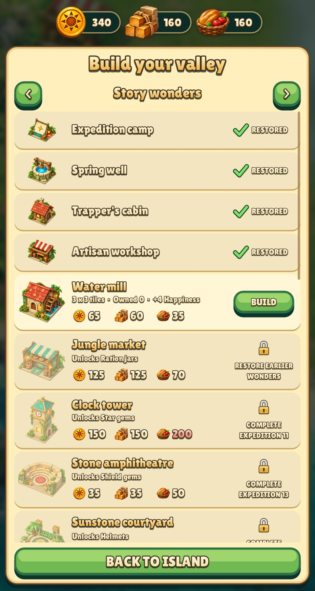
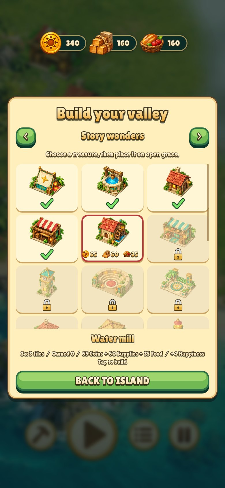
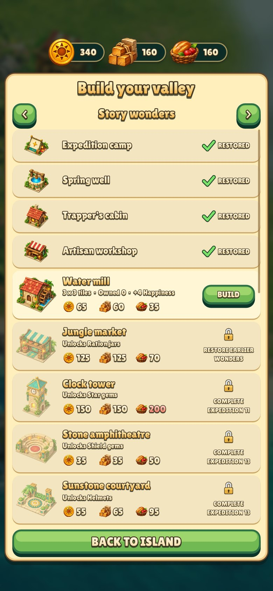
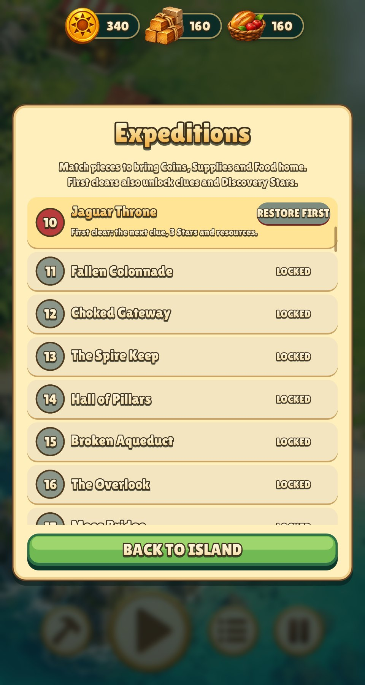
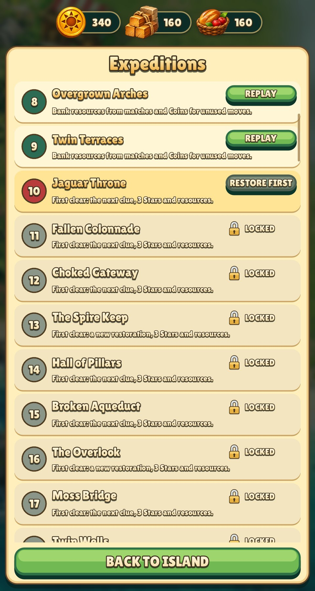
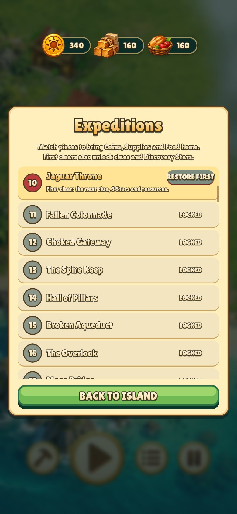
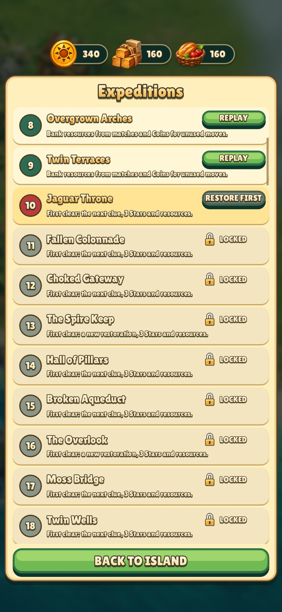

# Full-screen ledger lists

The build shop and the expedition list are full-screen sheets under the wallet
row, one entry per row. A building's row shows its whole price; an amount the
wallet cannot cover is red. Christmas Market shares the same templates.

| Screen | Before | After |
| --- | --- | --- |
| Shop, 480×900 |  |  |
| Shop, 390×844 |  |  |
| Expeditions, 480×900 |  |  |
| Expeditions, 390×844 |  |  |

```sh
./build/relic-rush --headless --mute --fresh --size 480x900 --catalogue wonder --shot shop.png
./build/relic-rush --headless --mute --fresh --size 390x844 --safe-area 0,47,0,34 --expeditions --shot levels-phone.png
```
