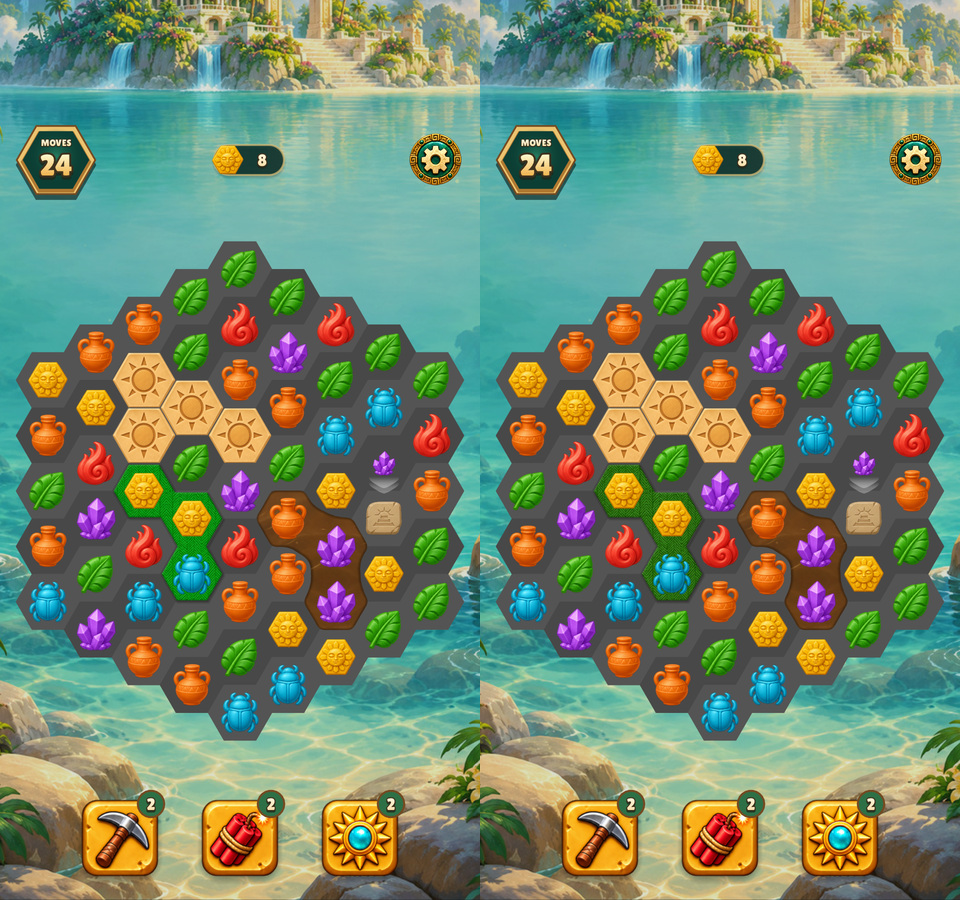
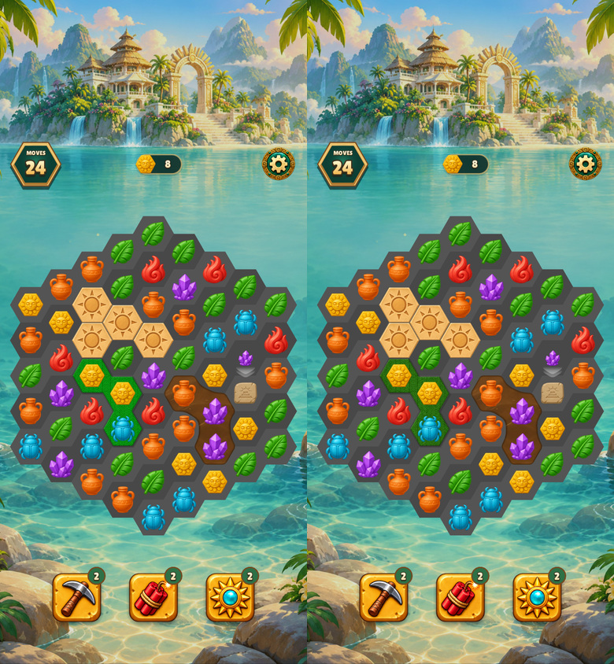

# Mid-green woven carpet

The left board shows the vivid Homescapes-inspired green. The right board shows
the mid-green revision. The carpet retains its weave and the goal icon shares
its palette.

| Phone size | Before and after |
| --- | --- |
| 480×900 |  |
| 390×844 |  |

The [palette swatch](../../../../../../art/match3-carpet-paint/mid-green-palette.png)
uses the RGB midpoint of the previous olive and vivid green swatches.
[ImageGen paint sheet](../../../../../../art/match3-carpet-paint/mid-green.png) ·
[Prompt](../../../../../../art/match3-carpet-paint/mid-green.prompt.txt)

```sh
python3 tools/match3_atlas.py
./build/test/all --suite=relic-rush 'shot element-states' 'shot phone-element-states'
```
