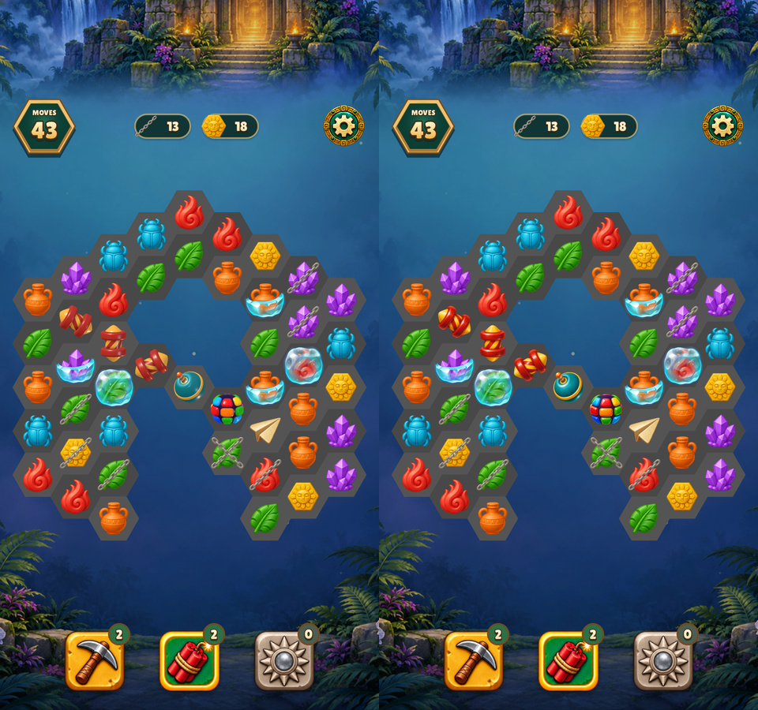
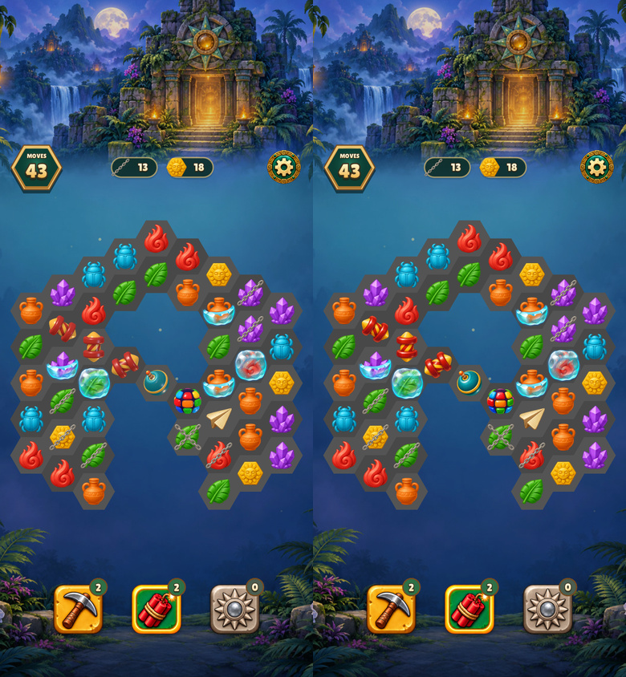

# Relic Rush power-up paint-over

The Scener renders are on the left and the painted chips are on the right.
The board shows the three rocket directions, bomb, rainbow gem and paper plane.

| Phone size | Scener renders and painted chips |
| --- | --- |
| 480×900 |  |
| 390×844 |  |

The [paint sheet](../../../../../../art/match3-power-up-paint/source.png),
[Scener edit target](../../../../../../art/match3-power-up-paint/scener-strip.png)
and [prompt](../../../../../../art/match3-power-up-paint/prompt.txt) cover both
games. The [atlas manifest](../../../../art/match3-atlas.json) records the
individual sprite crops, sizing and placement. The board and effects use
`data/match3.png`. The controls and HUD use `data/match3-hud.png`.

```sh
python3 tools/match3_atlas.py
./build/test/all --suite=relic-rush 'shot art-specials' 'shot phone-art-specials'
```
