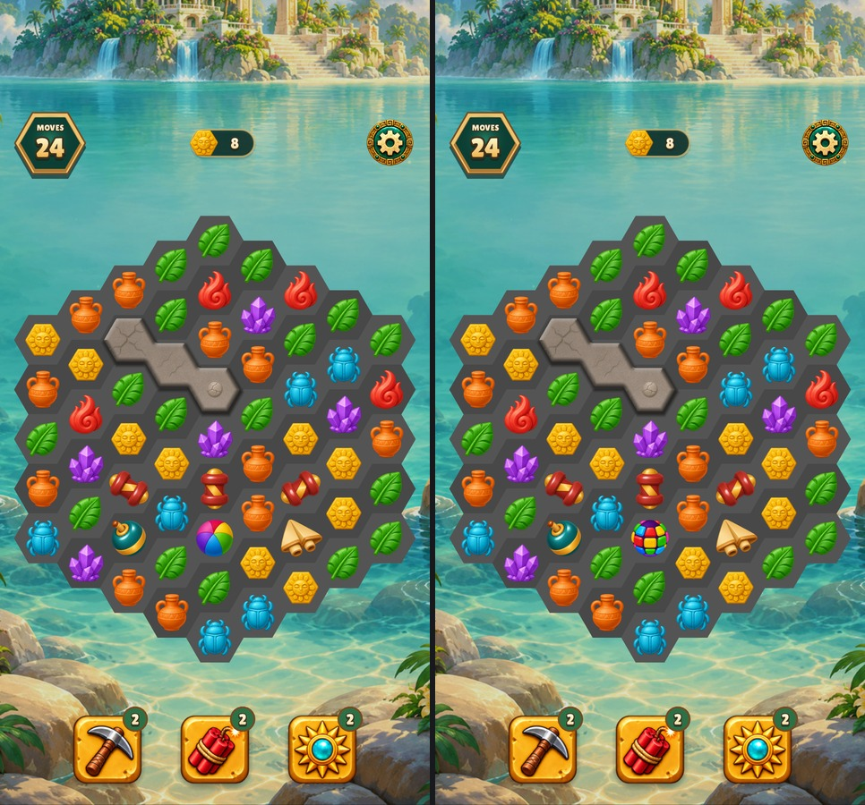
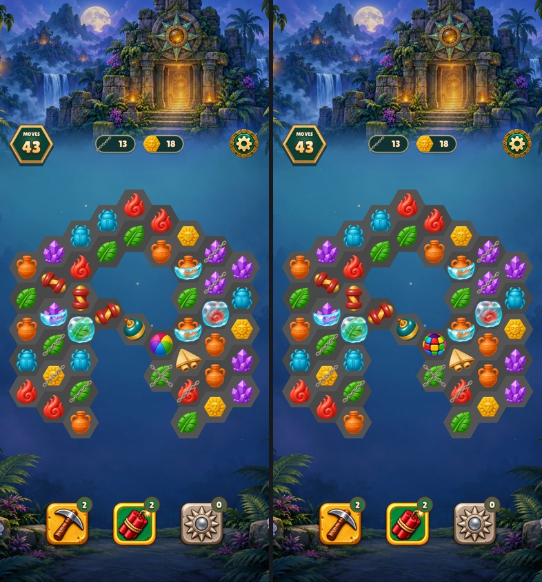

# Relic Rush rainbow ball

The previous ball is on the left and the revised ball is on the right. The
new ball has rounded enamel squares that wrap around a dark violet core.

| Board size | Before and after |
| --- | --- |
| 480 × 900 |  |
| 390 × 844 |  |

The [art guide](../../../../../../docs/MATCH3_ART_GENERATION.md) covers the
Homescapes reference and sizing. The games rendered these boards with the
existing specials-and-stone and phone specials captures.
