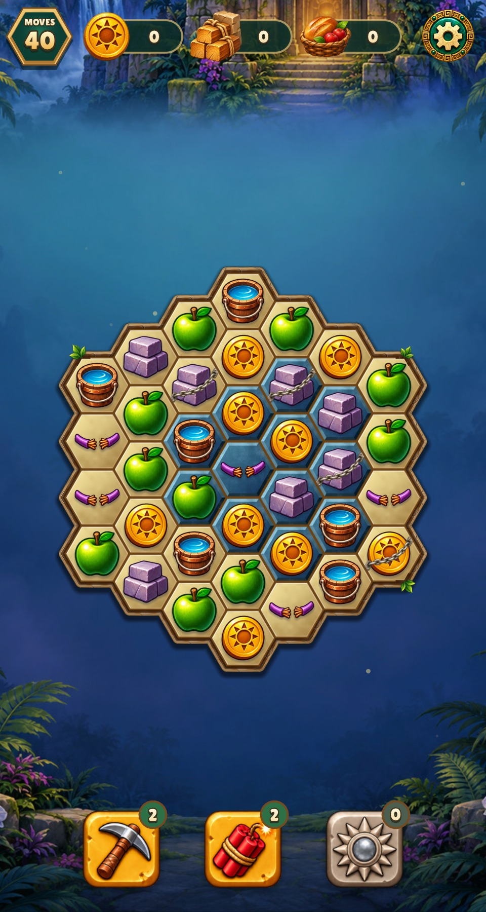
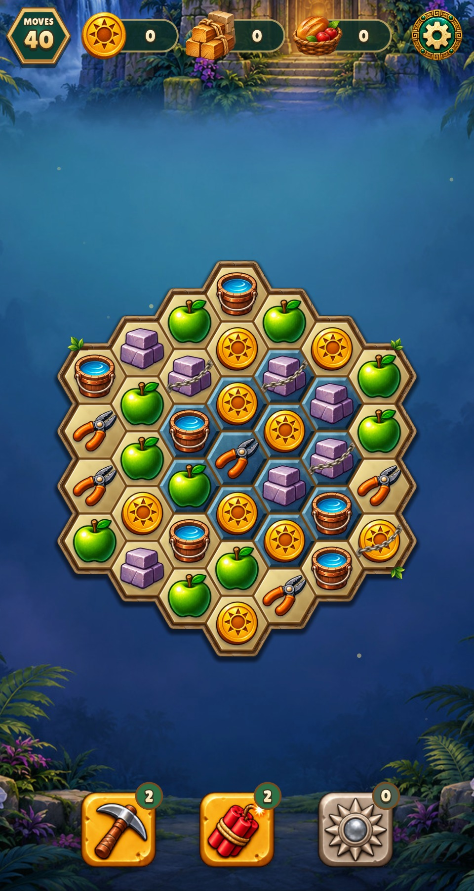
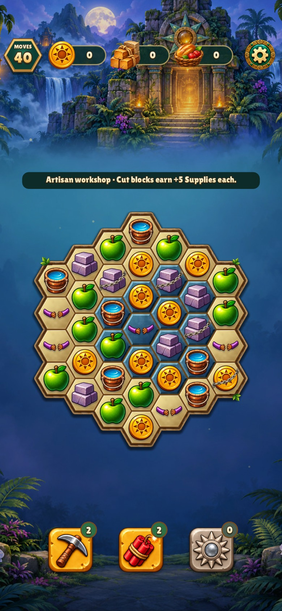
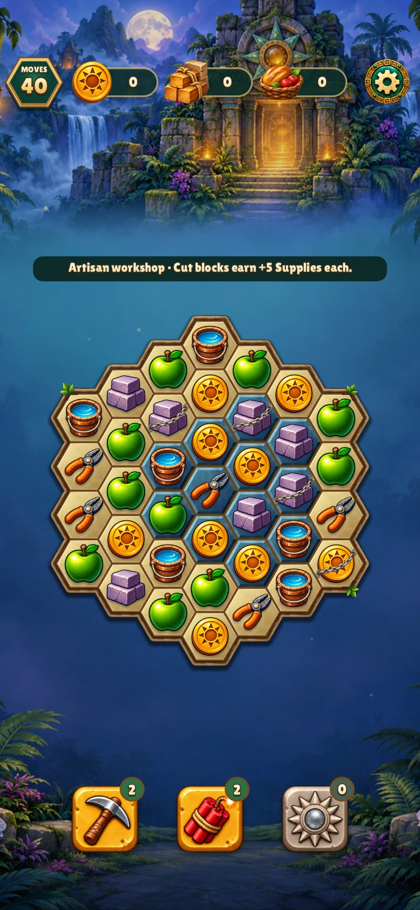
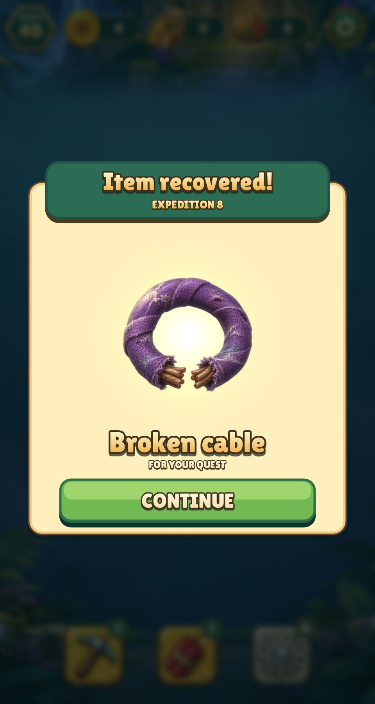
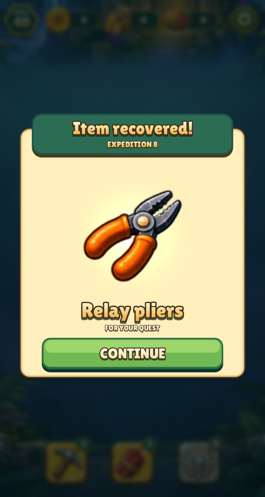
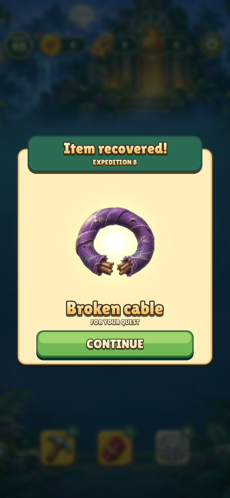
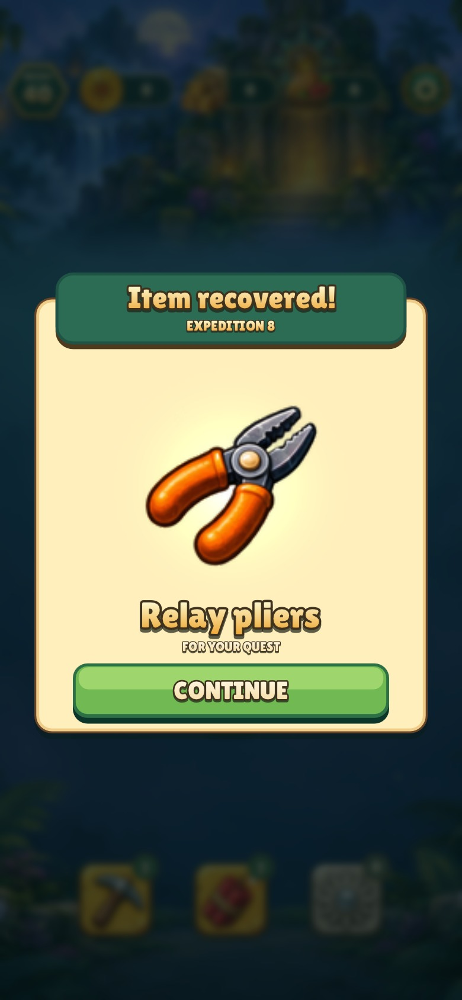
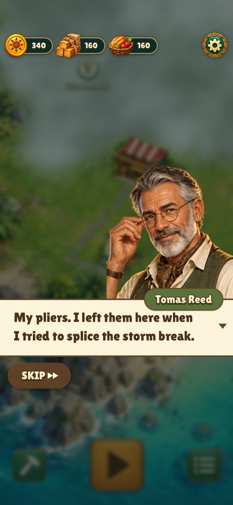

# Level 8 relay pliers

The orange-handled pliers are one region of the campaign atlas. The previews
and the recovery card draw from that region too.

| View | Before | After |
| --- | --- | --- |
| Board · 480×900 |  |  |
| Board · 390×844 |  |  |
| Recovery · 480×900 |  |  |
| Recovery · 390×844 |  |  |
| Level 8 story · 390×844 | |  |

`build/test/relic-rush "shot hex-late" "shot harbor-cable-phone" "shot relay-item-card" "shot relay-pliers-story-phone" "shot relay-pliers-alternate" "shot workshop-story-phone"`
