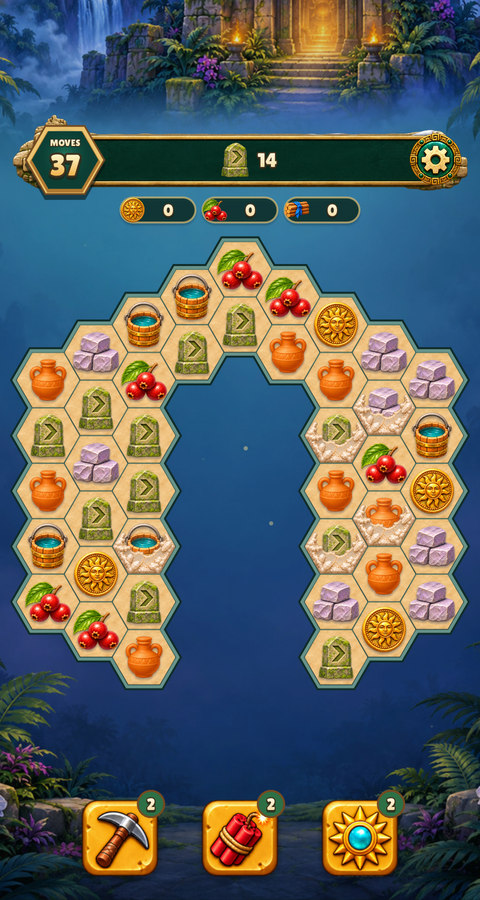
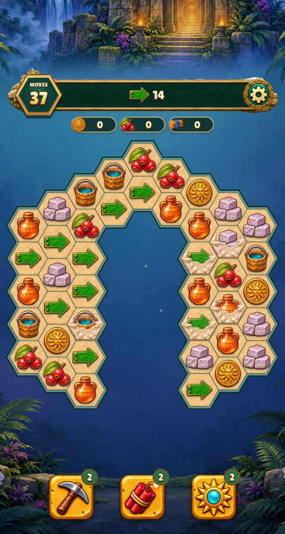
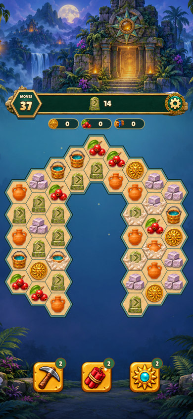
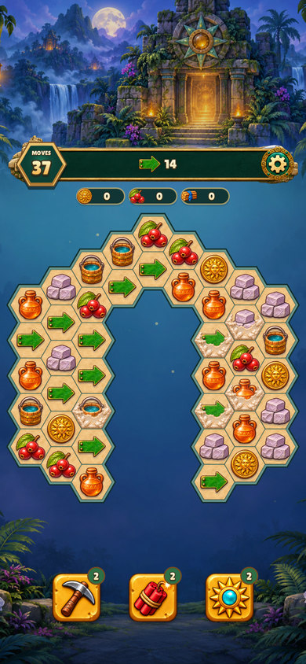
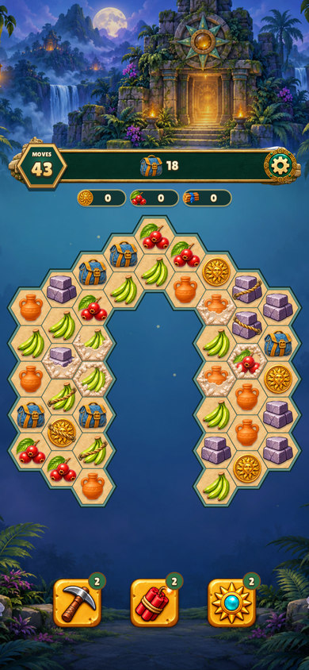
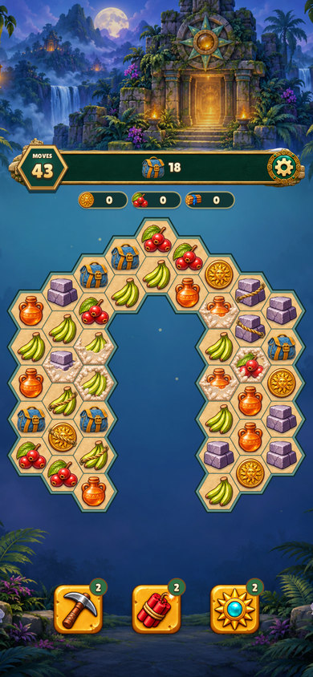
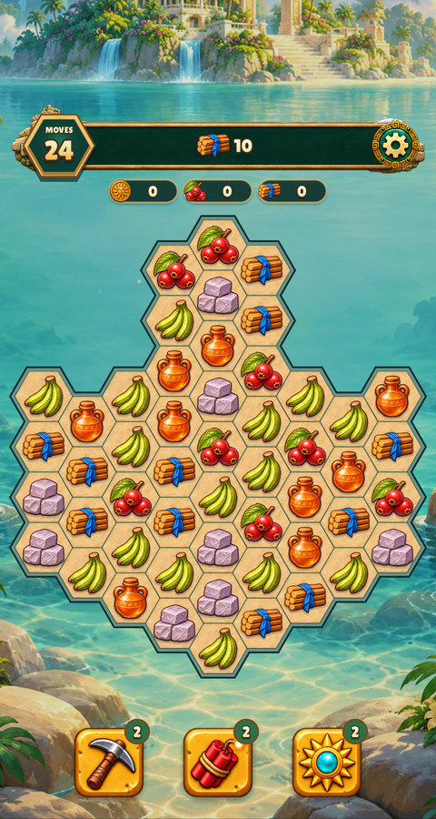
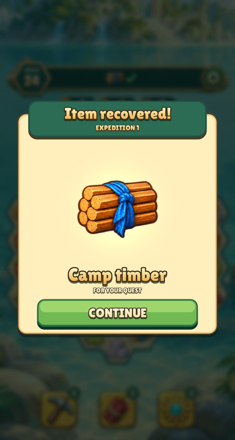
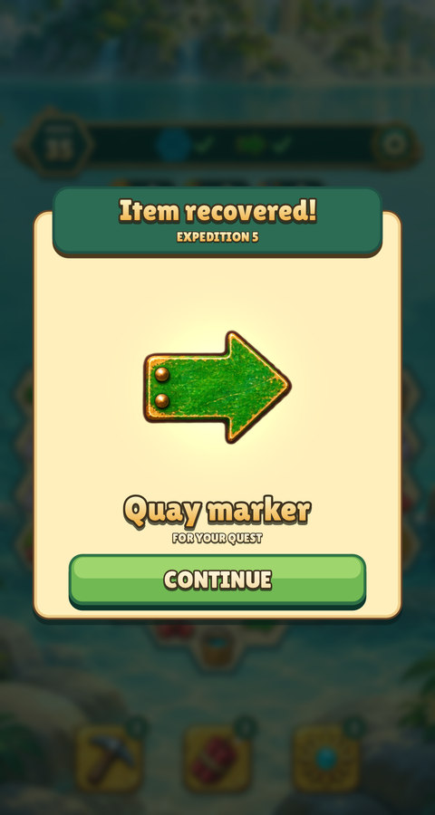
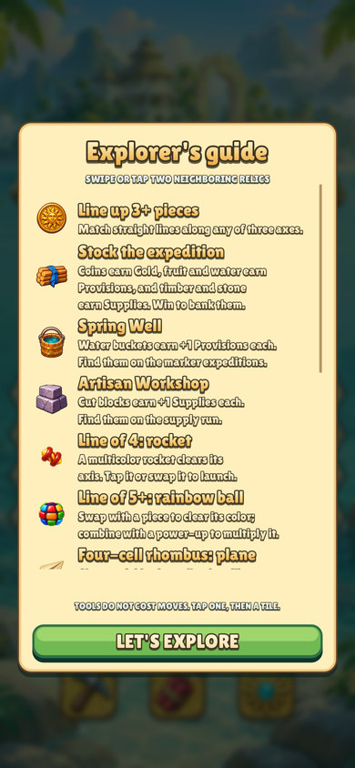

# Painted resource outlines

The everyday pieces use the warm dark contour of the Workshop cut blocks.
This includes the orange ration jar. The original dark cut blocks remain
the art reference. The wood match on First Light now uses the same blue-tied
timber as the rest of the expedition and earns Supplies as it advances the
camp goal. The green trail arrow replaces the stone marker on both marker
boards and their recovery cards.

| View | Before | After |
| --- | --- | --- |
| Shore Marker, 480 × 900 |  |  |
| Shore Marker, 390 × 844 |  |  |
| Supply Crate, 390 × 844 |  |  |

| First Light | Camp timber reward | Quay marker reward | Guide |
| --- | --- | --- | --- |
|  |  |  |  |

Capture the board and card views through the existing Relic Rush test runner.

```sh
build/test/relic-rush "shot dressing-shore" "shot phone-floating-hud" "shot hex-first" "shot timber-item-card" "shot marker-item-card" "shot phone-guide"
```

The [source atlas](../../../../art/resource-pieces/outlined-atlas.png) and
[prompts](../../../../art/resource-pieces/outlined-atlas.prompt.txt) record the
painted contours. The asset importers only crop, resize and center the sprites.
