# Restoration resources

The Spring Well gives the marker expeditions water buckets worth one
Provisions each. The Artisan Workshop gives the supply run cut blocks worth
one Supplies each. The blocks are the darker outlined sprite from the
original Resources sheet. The blue supply packs still fill the crate goal.

| View | Before | After |
| --- | --- | --- |
| Shore Marker briefing, 480 × 900 | 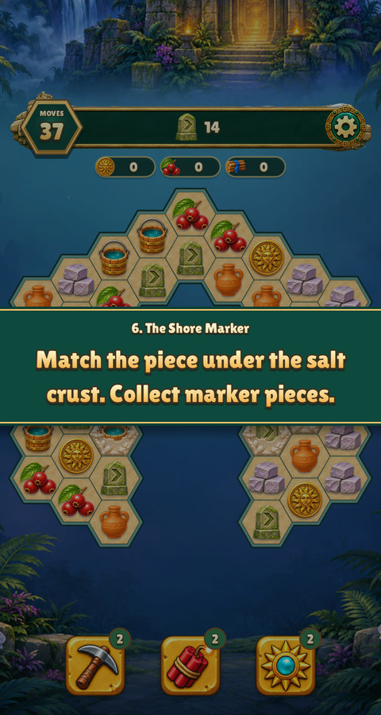 | 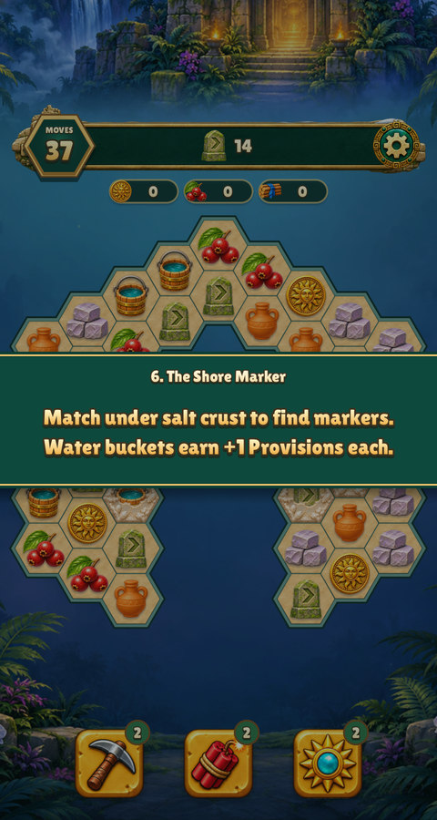 |
| Shore Marker briefing, 390 × 844 | 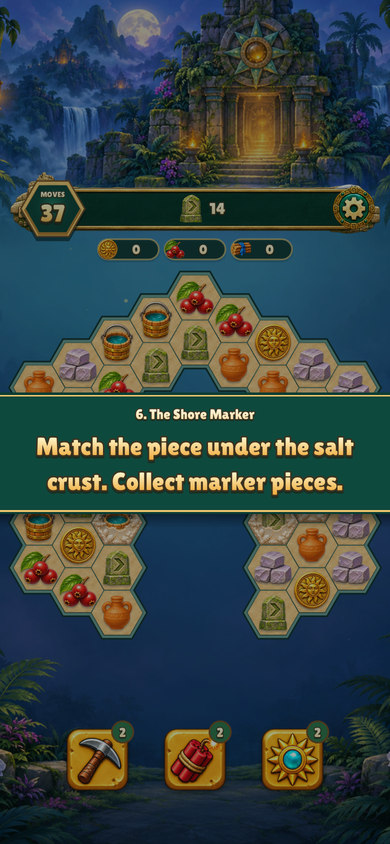 | 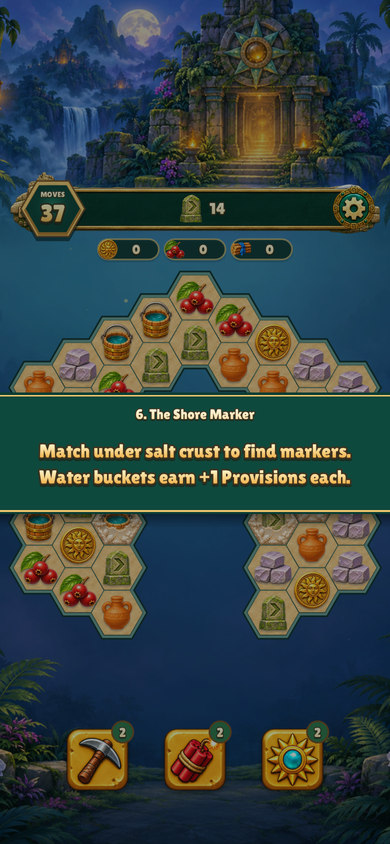 |
| Supply Crate board, 480 × 900 | 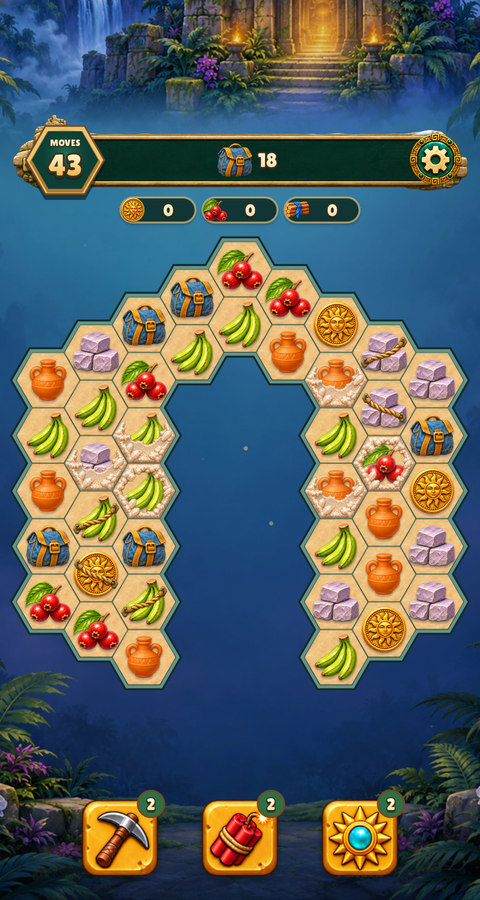 | 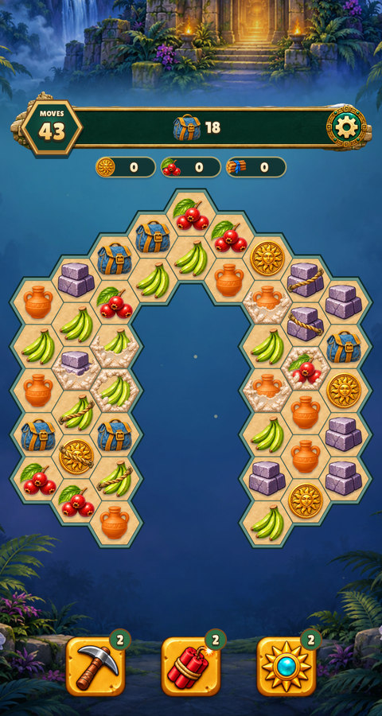 |
| Supply Crate board, 390 × 844 | 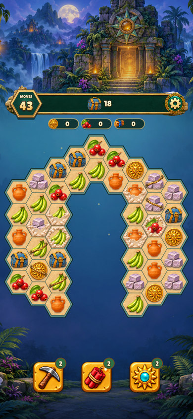 | 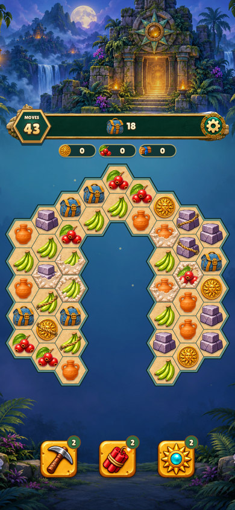 |

| Workshop briefing | Explorer’s guide | Supply crate handoff |
| --- | --- | --- |
| 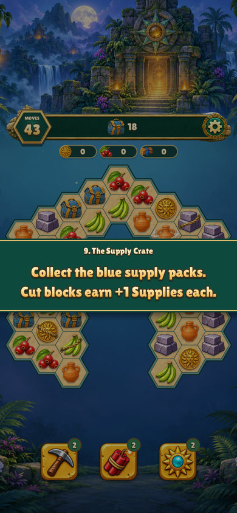 | 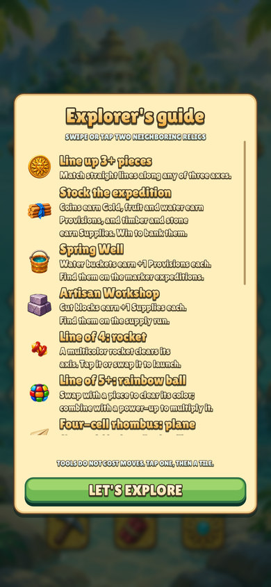 | 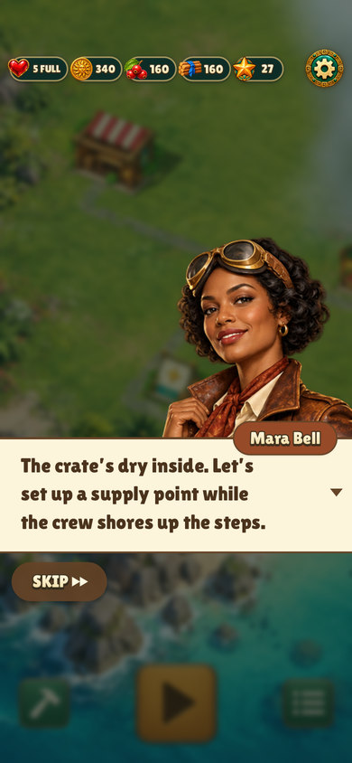 |

Reproduce the captures using the named Relic Rush tests.

```sh
build/test/relic-rush "shot dressing-lesson" "shot floating-hud" "shot phone-floating-hud" "shot workshop-lesson" "shot workshop-story" "shot phone-guide"
```

Use `--level 9 --before-workshop` in the game to preview the pale stone
palette before restoration. Ownership and earnings are exercised by
`"rules relic_wallet"`; `"smoke campaign"` follows the live story, claim
and placement sequence.
