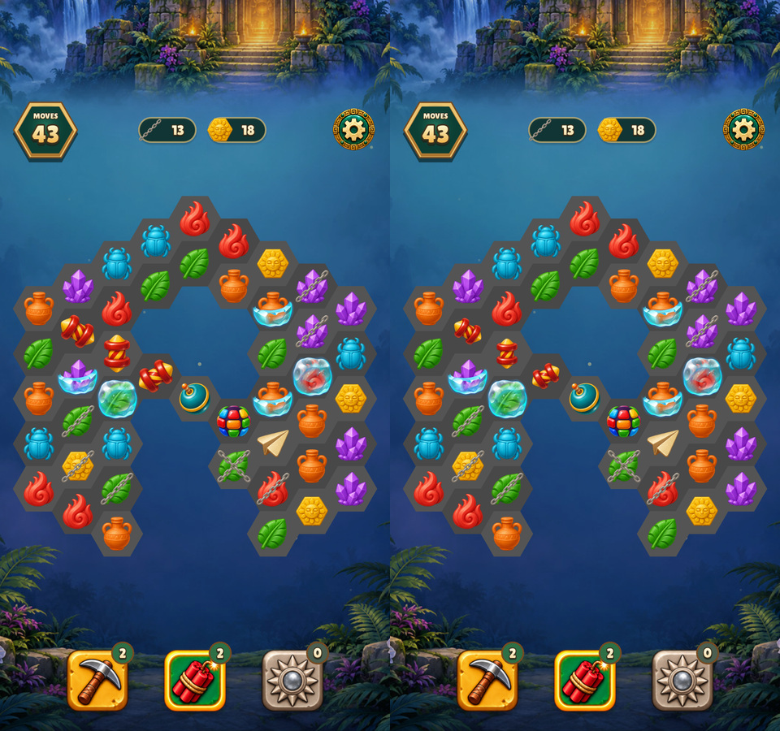
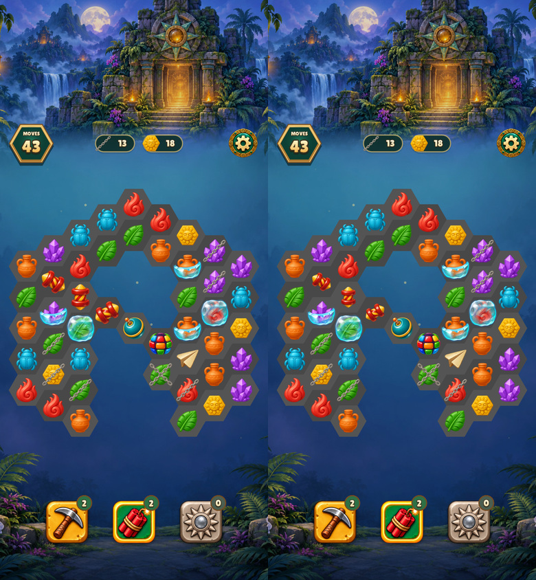

# Relic Rush rocket size

The boards show the previous size on the left and the 20% smaller rockets on
the right. Registration scales all three rocket axes uniformly around the
center of their cells.

| Phone size | Before and after |
| --- | --- |
| 480×900 |  |
| 390×844 |  |

```sh
python3 tools/match3_atlas.py
./build/test/all --suite=relic-rush 'shot art-specials' 'shot phone-art-specials'
```
