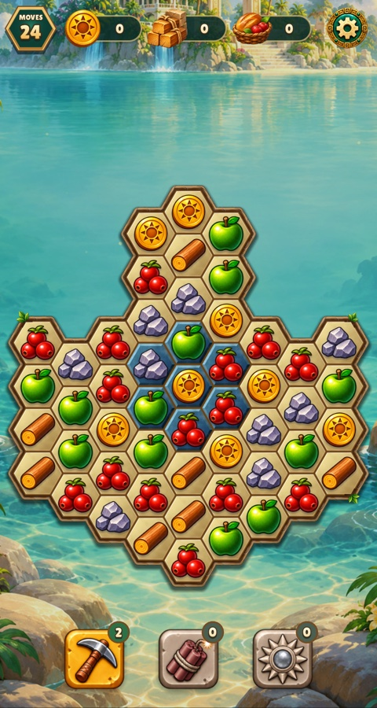
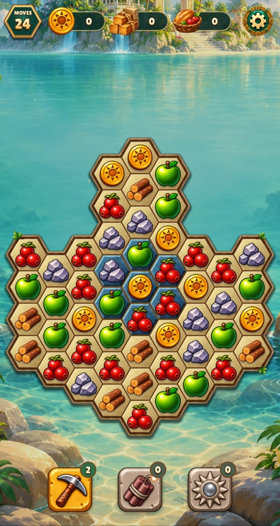
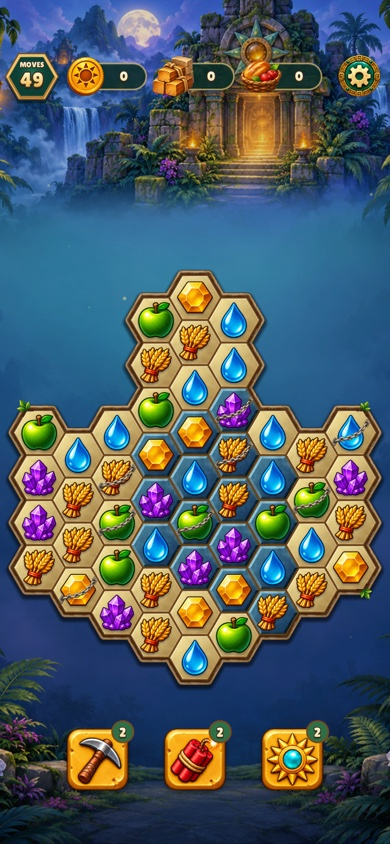
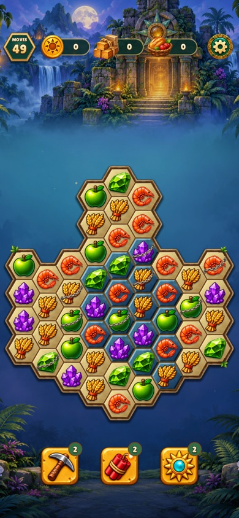

# Rome treasures and lumber

The Relic Rush campaign uses one built-in ImageGen atlas for the Roman finds,
shrimp, and the three-log timber bundle. The [gem correspondence sheet](../../../../../../docs/cradle-of-rome-reference/gem-correspondence.html)
shows the source motifs, campaign sprites, and per-piece credits.
The [source atlas](../../../../art/campaign-pieces/rome-treasures.png) and
[prompt](../../../../art/campaign-pieces/rome-treasures.prompt.txt) are tracked
with the [crop boxes and state mapping](../../../../art/board-states/manifest.json).

| Board and size | Before | After |
| --- | --- | --- |
| First Light, 480 × 900 |  |  |
| The Warning Returns, 390 × 844 |  |  |

The live review also covers the alternate sizes with `shot phone-board` and
`shot delivery-finale`, the timber reward with `shot timber-item-card`, and
the silver coin, helmet, ring, scarab, sandal and harp in
`shot designed-chambers`, `shot rome-helmet`, `shot rome-ring`,
`shot alternate-landing`, `shot rome-sandal` and `shot rome-harp-and-shrimp`.
The late pieces also appear in the two alternate packs in
`shot rome-emerald-resources` and `shot rome-emerald-jewels`.
The painted silhouettes retain their original alpha. The board uses the same
sprite in normal, selected, hinted and falling states, with its existing
selection, chain and hint layers.

From the repository root, run `python3 games/relic-rush/tools/prepare_resource_pieces.py`
to regenerate the runtime atlas and the standalone timber and Emerald.
