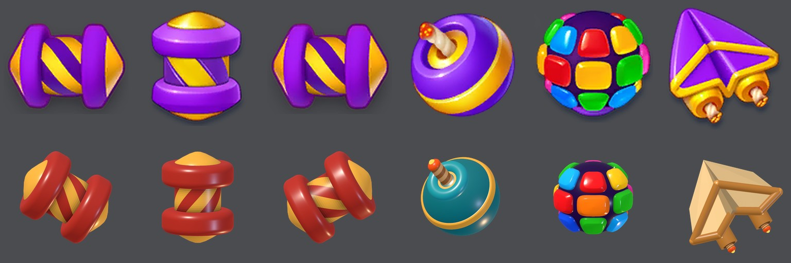
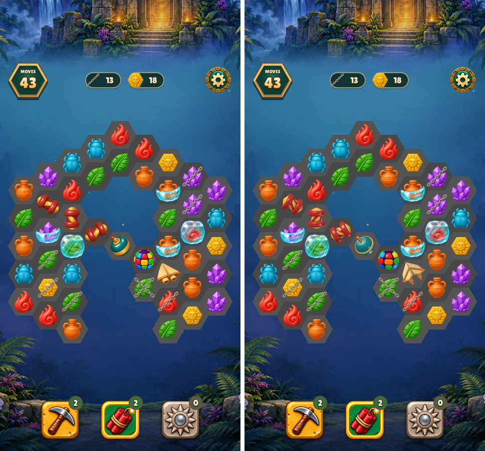
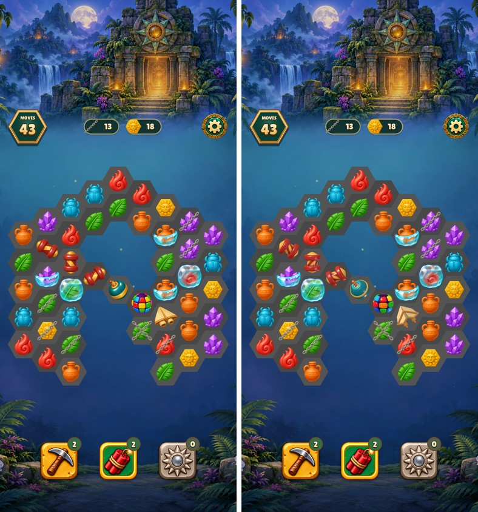

# Relic Rush power-ups modelled in Scener

The rockets, bomb, rainbow ball and plane are now 3D models rendered by
[Scener](../../../../../../docs/MATCH3_ART_GENERATION.md#model-the-power-ups).
The Homescapes references are on the top row and this game's renders are below.



The three rockets are one lathe turned about the view direction, so their
silhouettes are identical apart from the rotation. The bomb's belt is a band
around its sphere and each rainbow tile is a patch of the sphere's own
latitude and longitude. The plane is one folded sheet with a rim round its
rear fold and two rolled tubes under the tail.

Each board shows the previous painted sprites on the left and the renders on
the right.

| Board size | Before and after |
| --- | --- |
| 480 × 900 |  |
| 390 × 844 |  |

Render the sprites, repack the atlas and capture the boards with the existing
art-board shots.

```sh
python3 tools/match3_specials.py relic-rush
python3 tools/match3_atlas.py
./build/test/all --suite=relic-rush 'shot art-specials' 'shot phone-art-specials'
```
