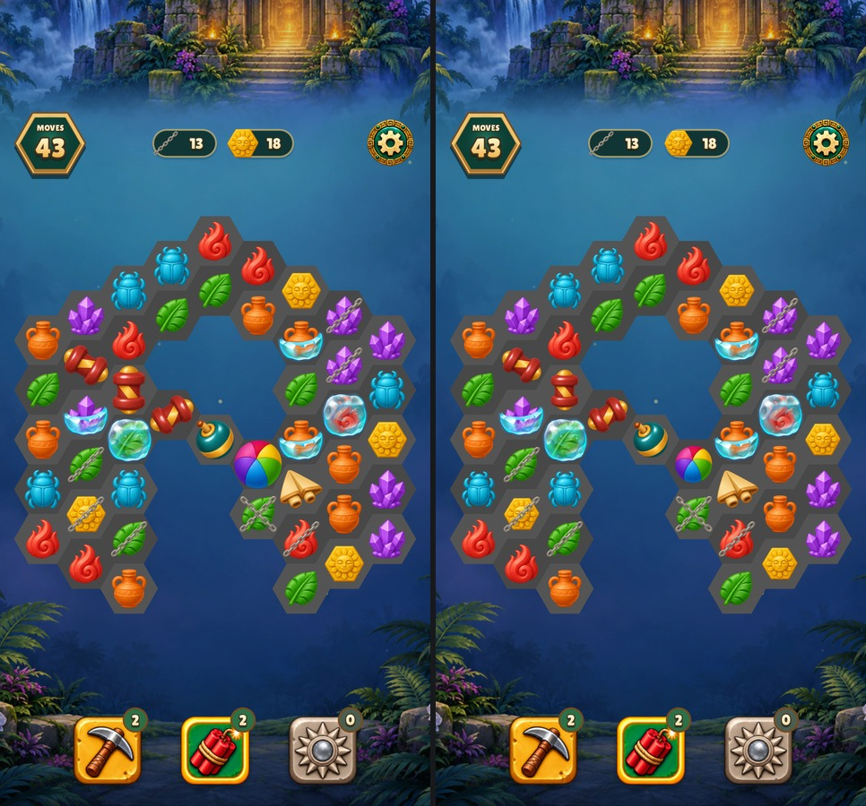
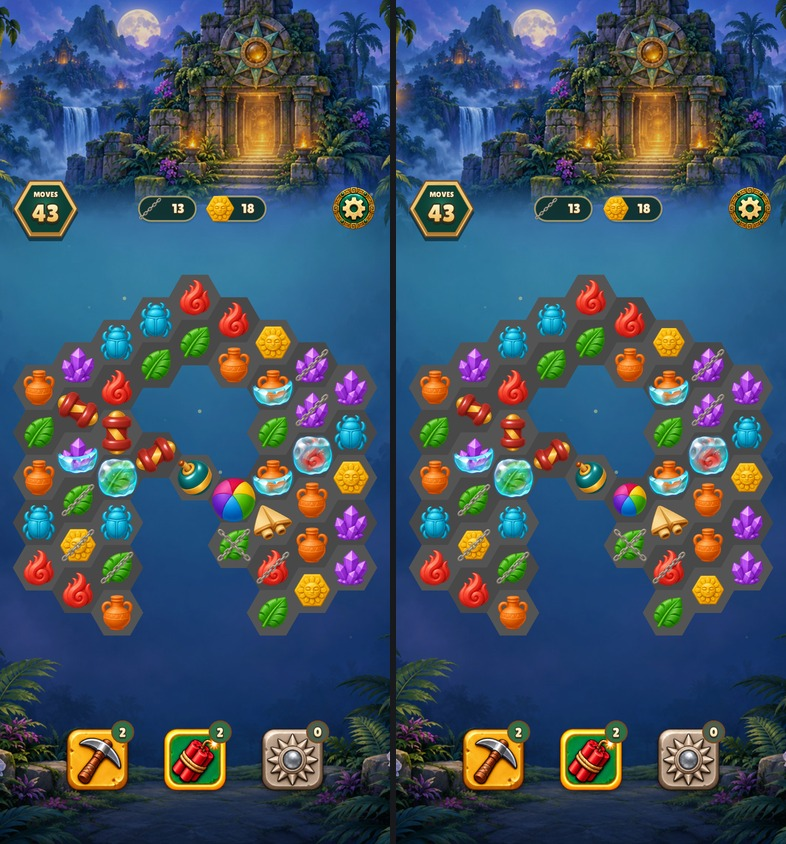

# Relic Rush sprite sizing

The previous board is on the left and the fitted board is on the right.
Both captures show the default chips, all three rockets, bomb, rainbow ball
and plane. The alpha masks set a shared size for each family while the inset
hex sets the maximum extent of each silhouette.

| Board size | Before and after |
| --- | --- |
| 480 × 900 |  |
| 390 × 844 |  |

The [art guide](../../../../../../docs/MATCH3_ART_GENERATION.md) describes the
measurement. Reproduce these captures with the game's existing \`--art-board\`
screenshot entries.
