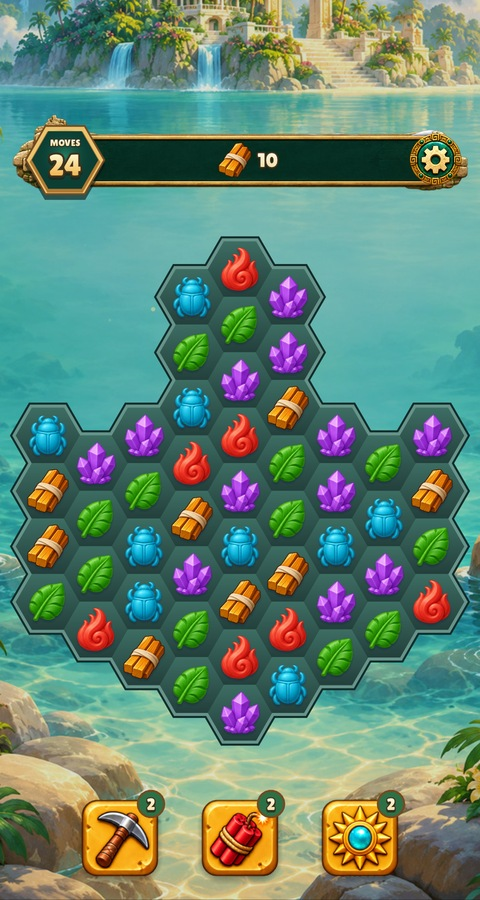

# Story pieces on the board

Each collection board has five match kinds. The story piece replaces the
slot closest to its colour. The goal shows the same icon and counts cleared
pieces. The first-clear card shows the recovered object.

| Board and viewport | Previous layout | Story collection |
| --- | --- | --- |
| 1, 480×900 |  |  |
| 4, 480×900 |  |  |
| 9, 480×900 |  |  |
| 9, 390×844 |  |  |

[Camp timber card](award-timber-480x900.jpg) ·
[Tide chart card](award-chart-480x900.jpg) ·
[Supply crate card](award-supplies-480x900.jpg)

The tiles fit within the canonical hex in strict object mode when registered
at the board's draw size. The goal and refill tests verify that each level
spawns five types and credits only the story piece.

```sh
SPRITE_SCENARIO=1 build/test/relic-rush \
  'frame scenario-relic-rush-board-01' 'frame scenario-relic-rush-board-04' \
  'frame scenario-relic-rush-board-09' 'shot supply-' 'shot timber-item-card' 'shot chart-item-card'
python3 tools/scenario_overview.py
```
