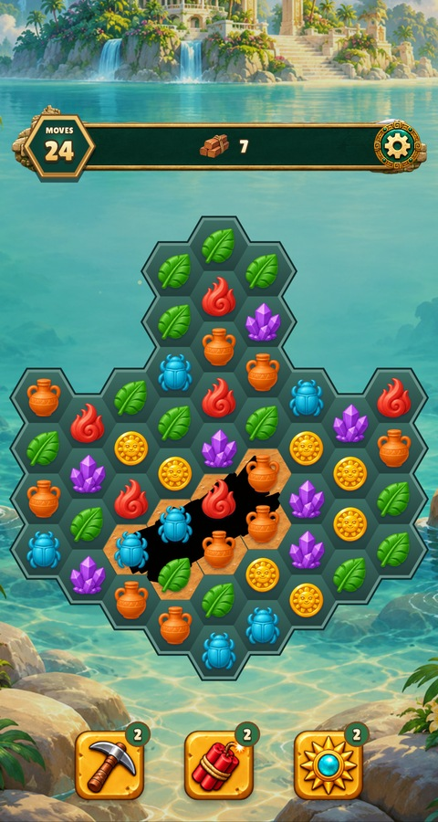
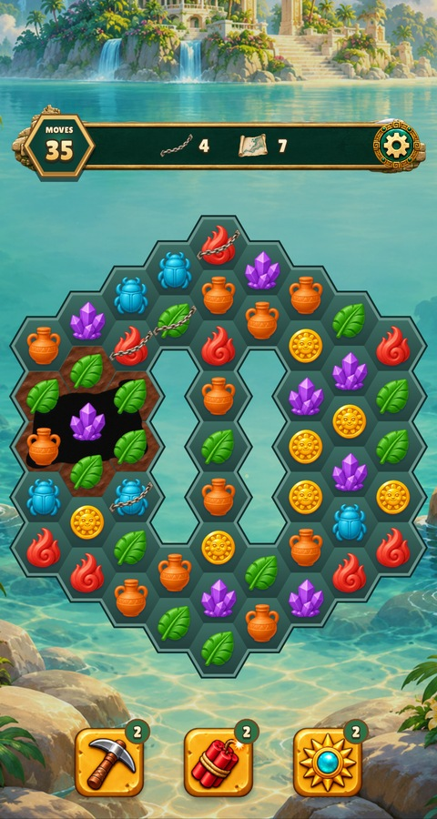
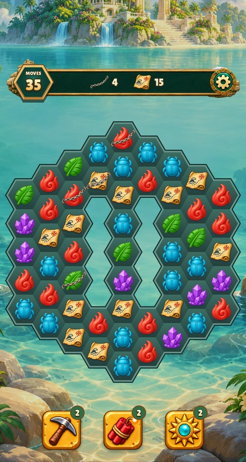
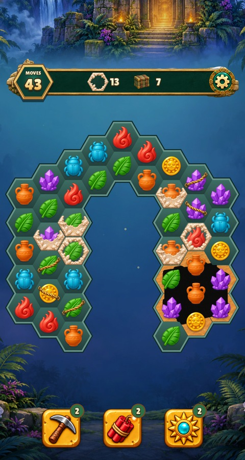
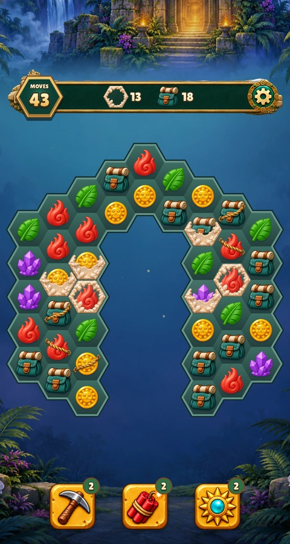
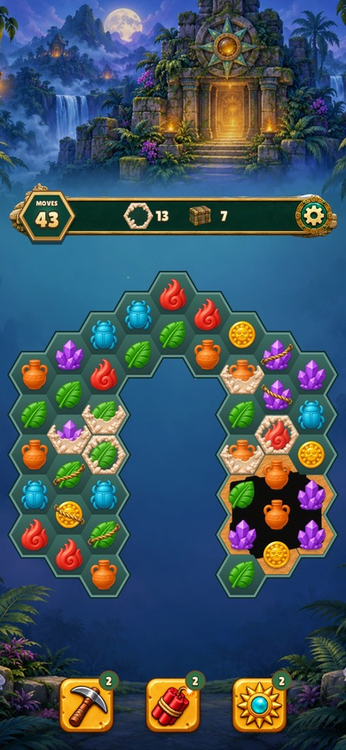
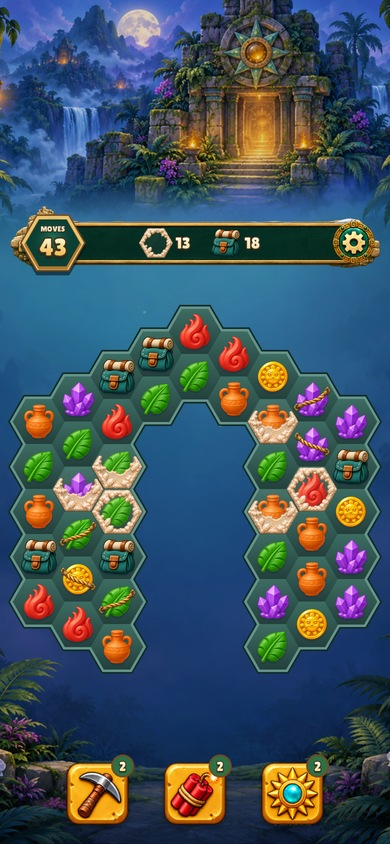

# Story pieces on the board

The story piece replaces the slot closest to its colour. The goal shows the
same icon and counts cleared pieces. The first-clear card shows the recovered
object. The [campaign data](../../../../lua/campaign.lua) sets each palette.

| Board and viewport | Previous layout | Story collection |
| --- | --- | --- |
| 1, 480×900 |  |  |
| 4, 480×900 |  |  |
| 9, 480×900 |  |  |
| 9, 390×844 |  |  |

[Camp timber card](award-timber-480x900.jpg) ·
[Tide chart card](award-chart-480x900.jpg) ·
[Supply crate card](award-supplies-480x900.jpg)

| Board | Palette | Replaced colour | Collection goal |
| --- | --- | --- | --- |
| 2 · Lamp Lens | 4+1 | Blue | [10 lenses](lens-480x900.jpg) |
| 3 · Relay Cable | 5+1 | Purple | [12 cable coils](cable-480x900.jpg) |
| 5 · Quay Marker | 4+1 | Green | [14 marker pieces](quay-marker-480x900.jpg) |
| 6 · Shore Marker | 5+1 | Green | [14 marker pieces](shore-marker-480x900.jpg) |
| 7 · Tool Roll | 5+1 | Red | [16 tool rolls](tools-480x900.jpg) |
| 10 · Shutter Gear | 4+1 | Orange | [20 gears](gear-480x900.jpg) |
| 13 · Names in the Stone | 4+1 | Gold | [14 folded notes](note-480x900.jpg) · [390×844](note-390x844.jpg) |

Board 3 plays the three flashes before the [relay cable card](award-cable-480x900.jpg).
Board 10 shows the [bronze gear](award-gear-480x900.jpg), then
[Tomas opens the near shutter](gear-story-480x900.jpg).
The [board 13 item card](award-note-480x900.jpg) shows the warning and initials
before the courtyard scene. [Note card at 390×844](award-note-390x844.jpg)

The tiles fit within the canonical hex in strict object mode when registered
at the board's draw size. The goal and refill tests verify that each level
spawns its configured palette and credits only the story piece.

```sh
SPRITE_SCENARIO=1 build/test/relic-rush \
  'frame scenario-relic-rush-' 'shot supply-' 'shot timber-item-card' 'shot chart-item-card' \
  'shot cable-item-card' 'shot note-collection-phone' 'shot note-award-phone' 'shot gear-story'
python3 tools/scenario_overview.py
```
