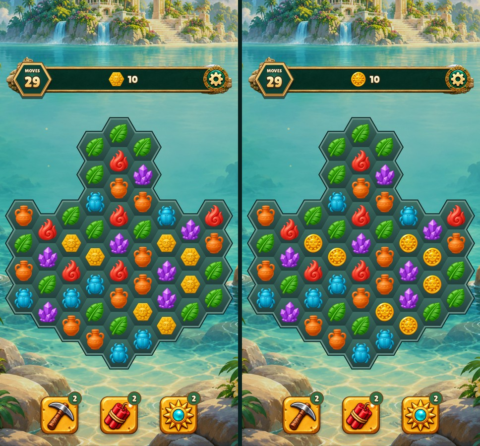
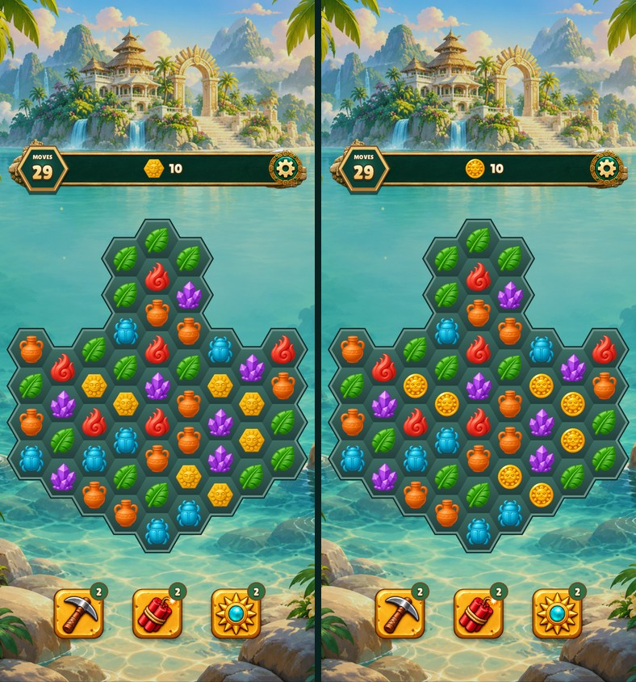
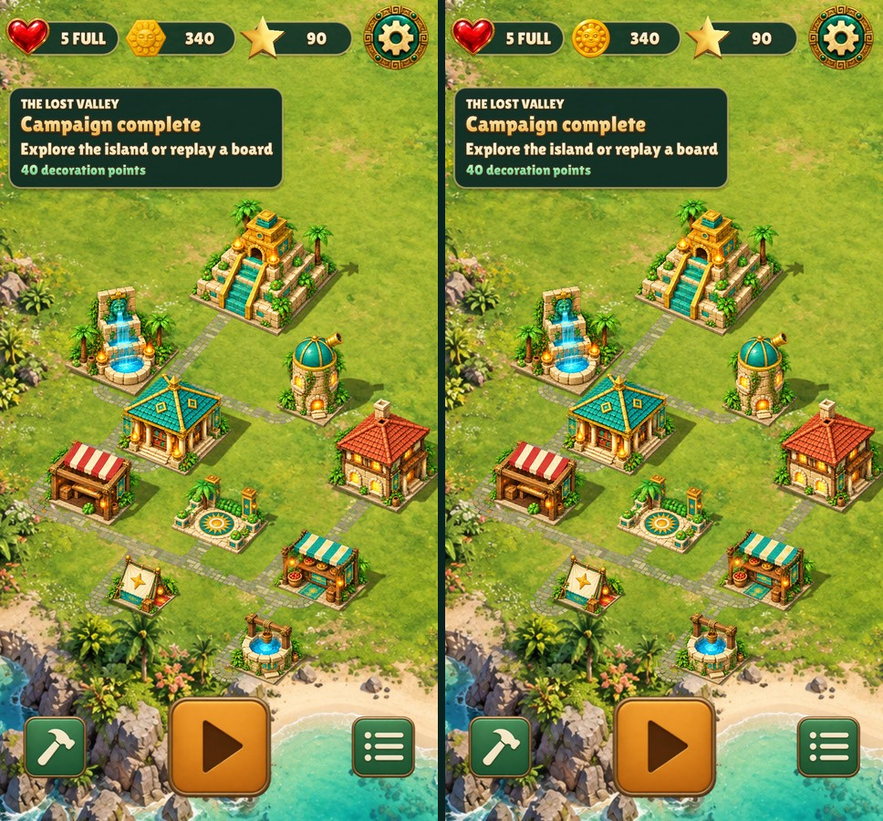
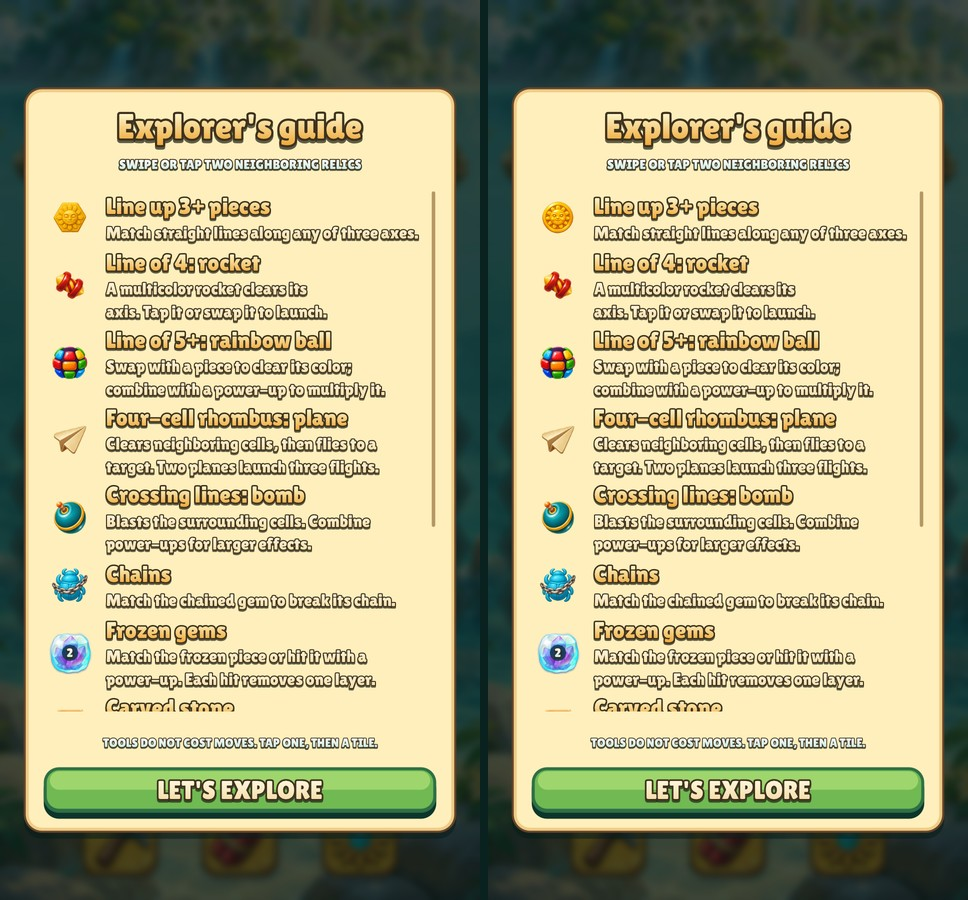
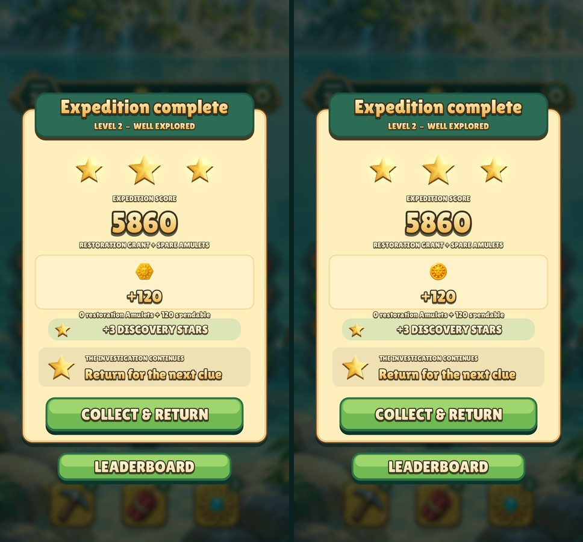

# Round sun coin

The default Relics idol now uses the round gold coin from concept A. It also
appears in idol objectives, the Explorer's Guide and the Amulet displays.
The comparisons show the previous hex medallion on the left and the round
coin on the right.

| Phone size | Before and after |
| --- | --- |
| 480 × 900 |  |
| 390 × 844 |  |

| Screen | Before and after |
| --- | --- |
| Island wallet |  |
| Explorer's Guide |  |
| Expedition results |  |

The [specials board](art-specials.jpg) shows the coin under a chain. The
[artwork catalogue](art-catalogue.jpg) shows the three packs and the overlays
and tools they share. The [source sprite](../../../../art/board-theme/sun-coin/source.png),
[approved concept](../../../../art/board-theme/sun-coin/concept.png) and
[production prompt](../../../../art/board-theme/sun-coin/prompt.txt) are kept
with the [atlas registration](../../../../art/match3-atlas.json).

```sh
python3 tools/match3_atlas.py
build/test/relic-rush 'shot goal-board' 'shot art-specials' 'shot art-catalogue' \
    'shot island-village' 'shot guide' 'shot victory'
```
