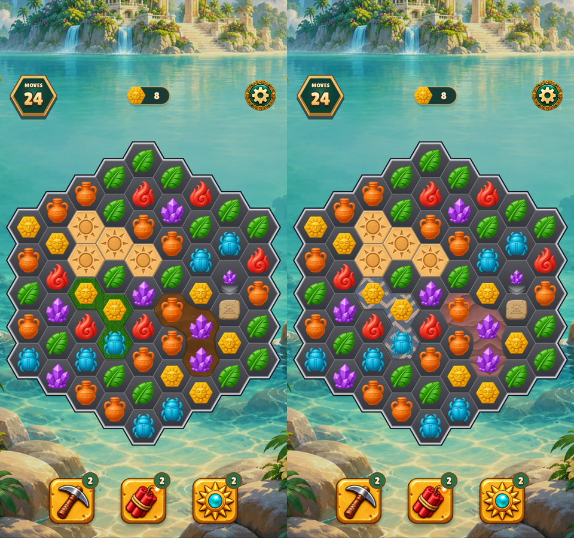
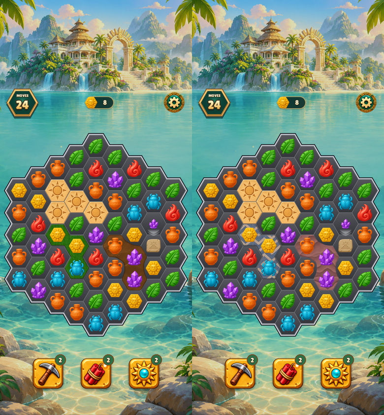

# Restored mosaic and river silt

Each comparison shows the previous board on the left and the new terrain on
the right. Both materials sit under the chips and share goal icons with the
guide and HUD.

| Phone size | Before and after |
| --- | --- |
| 480 × 900 |  |
| 390 × 844 |  |

The [ImageGen sheet](../../../../../../art/match3-terrain/source.png),
[prompt](../../../../../../art/match3-terrain/prompt.txt), and
[registration manifest](../../../../art/match3-atlas.json) record the materials
and icons. The familiar engine goal IDs control growth and clearing.

```sh
python3 tools/match3_atlas.py
./build/test/all --suite=relic-rush 'shot element-states' 'shot phone-element-states'
```
