# Relic Rush wallet and expedition score

The town and expedition header shows Coins, Supplies and Food. Expedition
score appears in the completion dialog. The Supplies and Food artwork is
shared by the top bar, shop prices and completion rewards.

| Screen | Before | After |
| --- | --- | --- |
| Expedition, 480 × 900 | 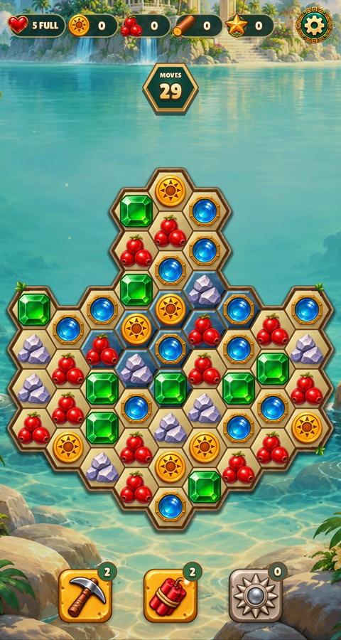 | 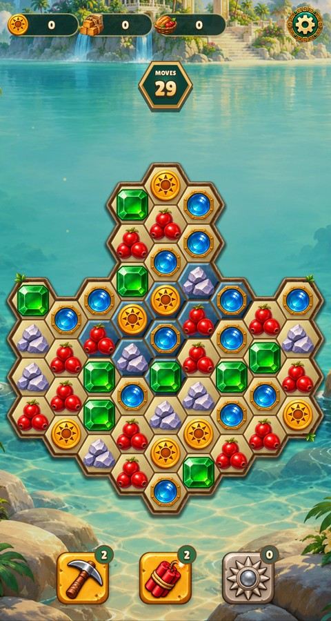 |
| Expedition, 390 × 844 | 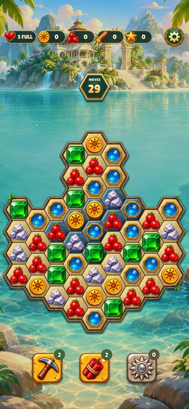 | 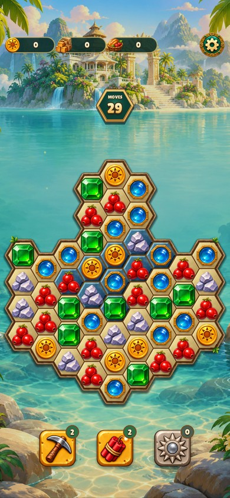 |
| Town, 480 × 900 | 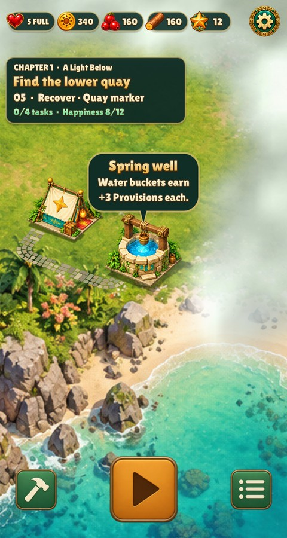 | 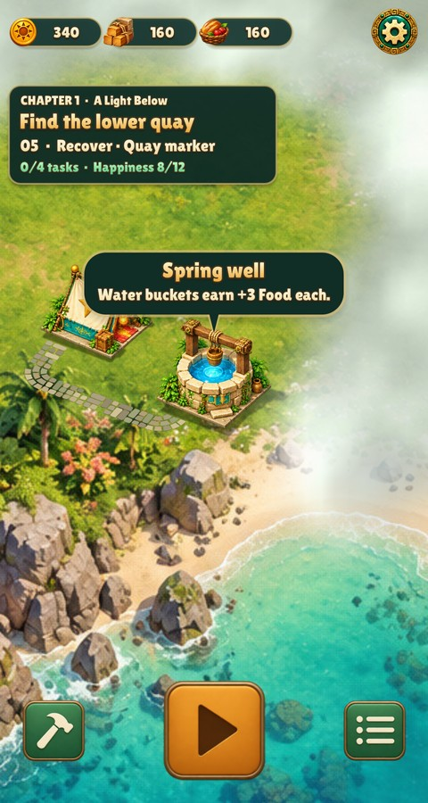 |
| Town, 390 × 844 | 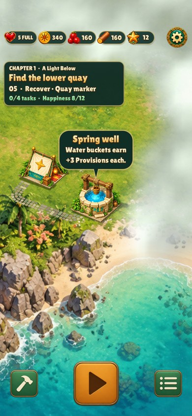 | 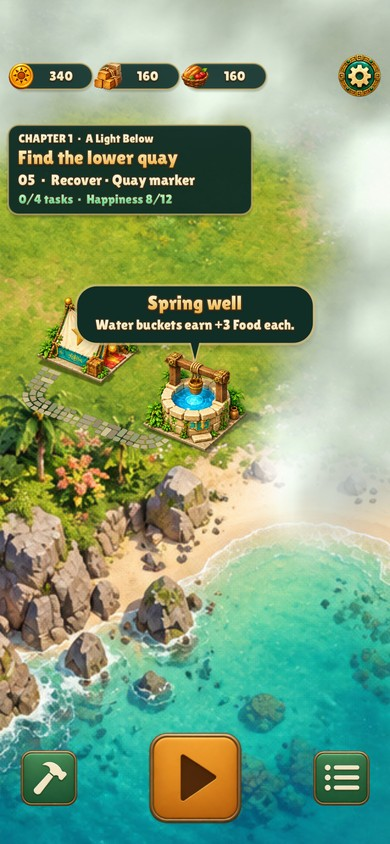 |
| Completion | 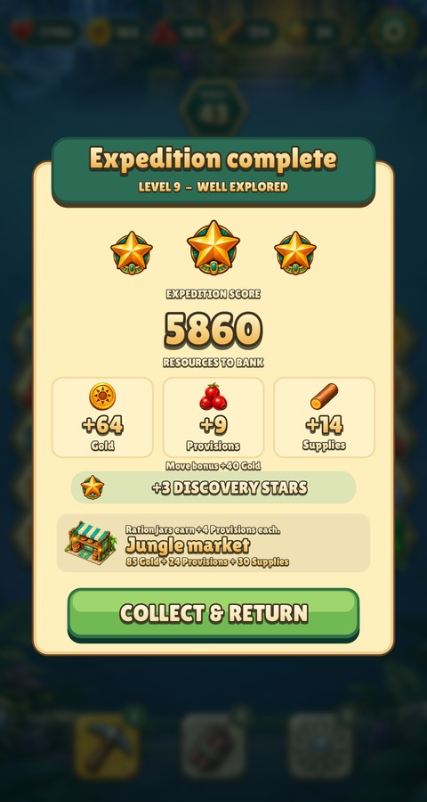 | 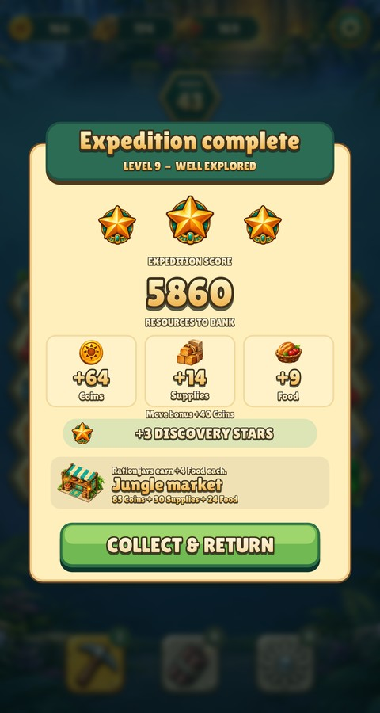 |
| Price card | 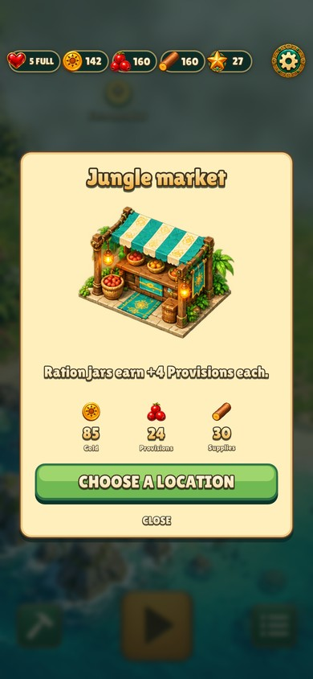 | 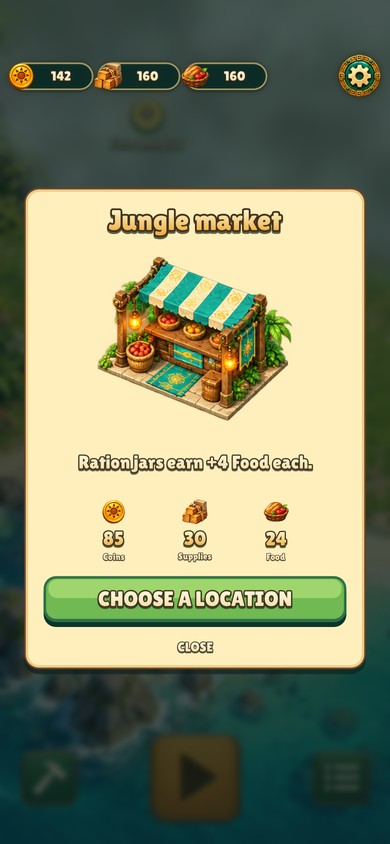 |

Run `build/test/relic-rush "shot goal-board" "shot island-bubble" "shot phone-island-bubble" "shot economy-result" "shot economy-price-phone"` to reproduce the current captures.
