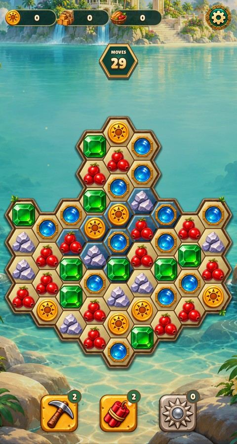
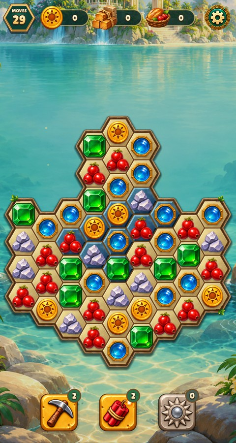
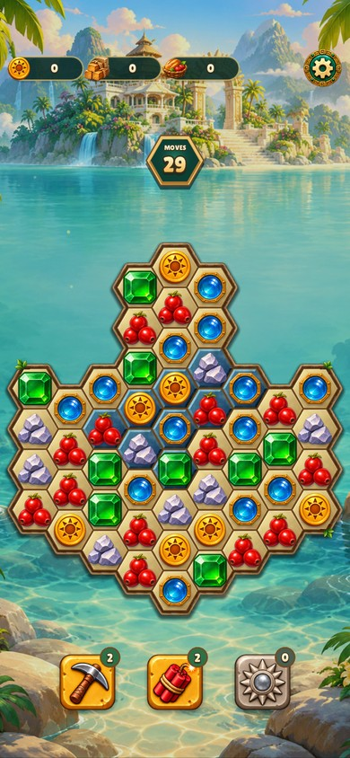
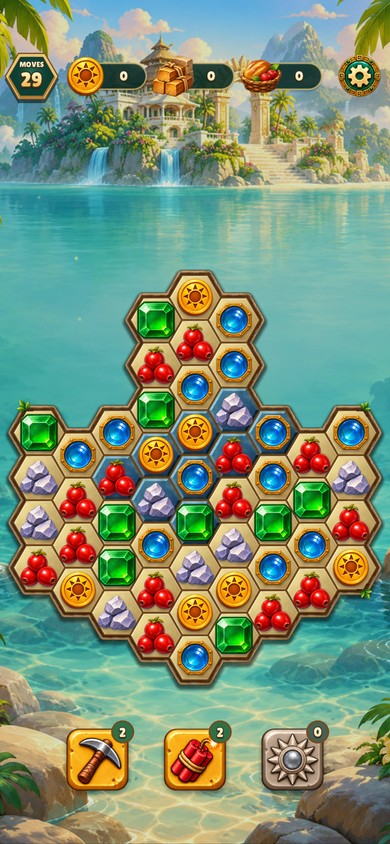
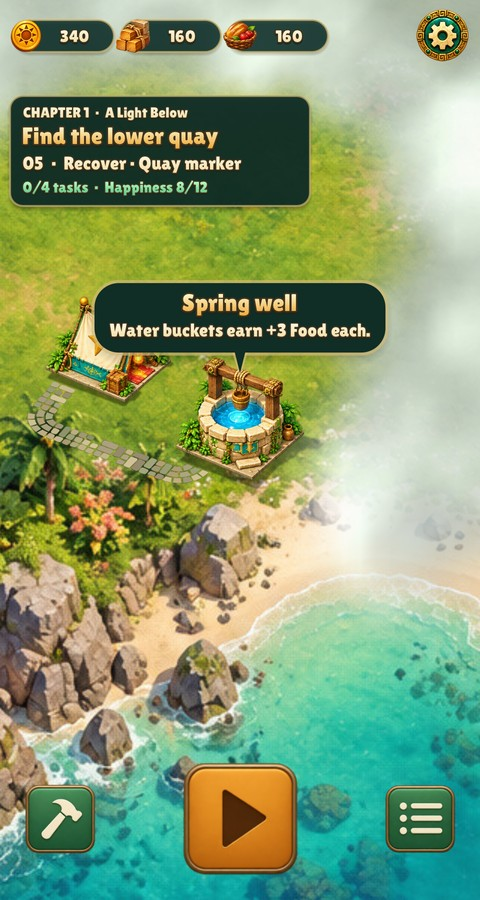
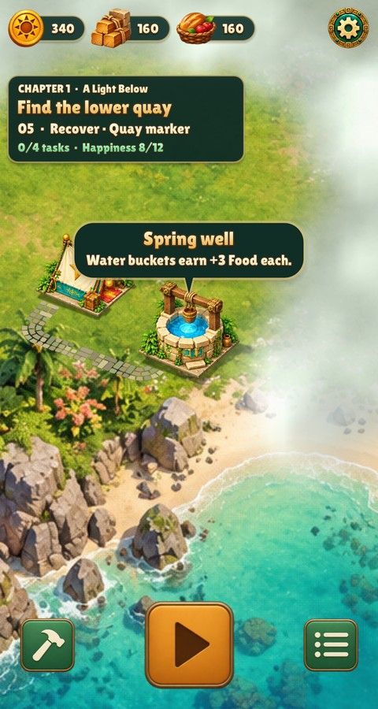
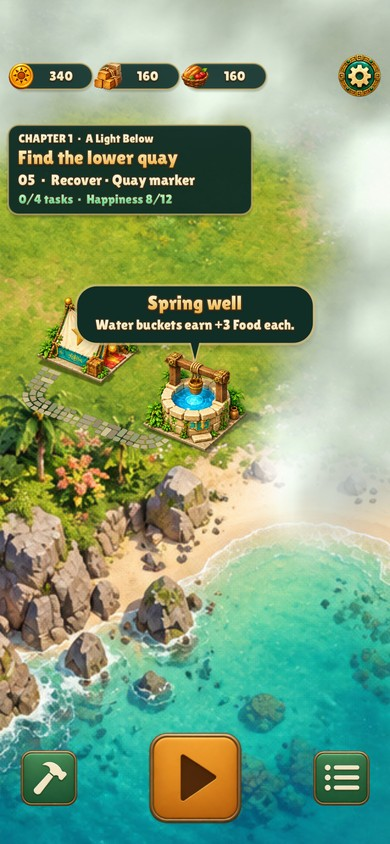
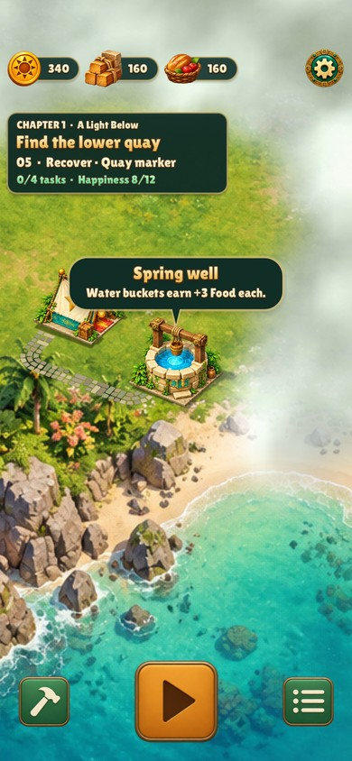

# Relic Rush top bar

The resource icons are 50% larger. The horizontal gap between pills is
18 logical pixels, up from 7. On expeditions, Moves sits to the left of
Coins, Supplies and Food on the same row as Settings.

| Screen | Before | After |
| --- | --- | --- |
| Expedition, 480 × 900 |  |  |
| Expedition, 390 × 844 |  |  |
| Town, 480 × 900 |  |  |
| Town, 390 × 844 |  |  |

Run `build/test/relic-rush "shot goal-board" "shot island-bubble" "shot phone-island-bubble"` to capture these views.
