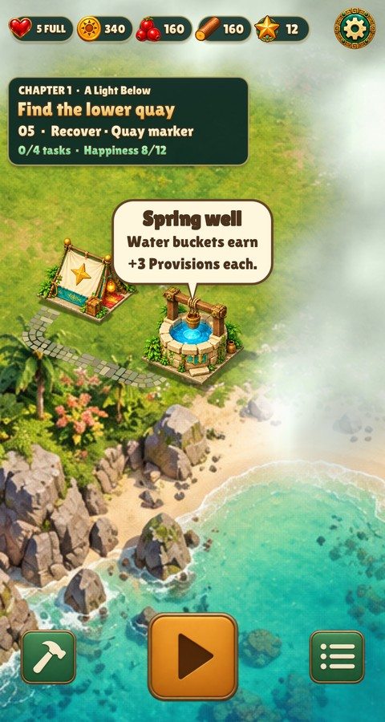
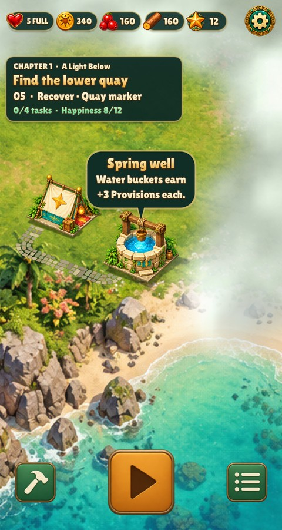
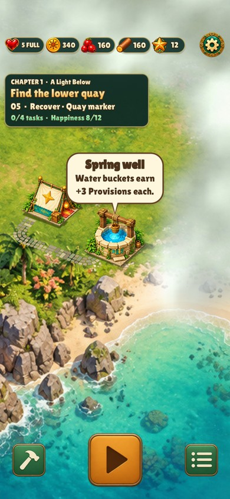
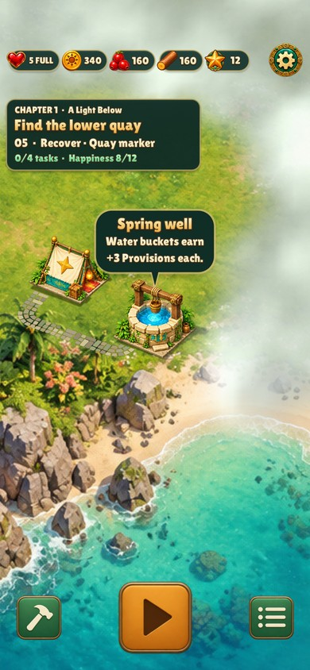

# Relic Rush building labels

The engine's town popup uses the Relic Rush quest panel's green background,
gold border and title, and cream subtitle. The tail points to the tapped building.

| Size | Before | After |
| --- | --- | --- |
| 480 × 900 |  |  |
| 390 × 844 |  |  |

Run `build/test/relic-rush "shot island-bubble" "shot phone-island-bubble"` to
capture both sizes.
