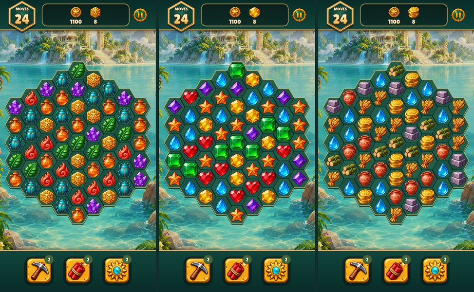

# Tile art comparison — 29 October 2026

Three original six-piece sets are available as art packs; **set 1 (Relics) is the production default**. Gameplay, rewards and construction costs are the same with every pack. The original generated source is `art/tile-sets/source.png` (a 6 × 3 sheet, one pack per row, pieces in rule order); `tools/prepare_assets.py` isolates each piece's main component and cuts it into `data/tile-sets/<pack>/0..5.png`, removing neighbouring fragments. See the [complete artwork/state catalogue](asset-catalogue.md) for all special frames, blocker strengths and tool states.

1. **Relics**: hex sun idol, flame, leaf, scarab, crystal cluster, amber amphora.
2. **Jewels**: yellow hexagon, red heart, green square, blue drop, purple diamond, orange star.
3. **Resources**: coins, terracotta, timber, water, stone, wheat. These are visual replacements only; water, terracotta and wheat are not new economy currencies.

## Choose a pack

- Native: `./build/relic-rush --tiles jewels` (or `resources`).
- Web: open `.../relic-rush/?tiles=jewels`. The engine passes the page's query string to the game as command-line options, so the same code reads it; no loader hooks or repacked data files are needed.
- Anything else, or nothing, selects Relics.

`tools/screenshots.py` renders the comparison above from the running game.

## Construction research

Checked current official support documentation, rather than generalizing across Wooga games:

- [June's Journey: buildings](https://wooga.theymes.com/hc/en/junes-journey/articles/what-are-buildings-322): buildings require construction time and materials and generate coins once built; a star requirement unlocks each building.
- [June's Journey: materials](https://wooga.theymes.com/hc/en/junes-journey/articles/what-are-materials-for-and-how-do-i-get-them-324): wood, hammer and brick are common, paint is less common; porcelain, copper, glass, terracotta and marble are rare. Materials come from Star Boxes and hidden-object scene bonus rewards.
- [June's Journey: upgrades](https://wooga.theymes.com/hc/en/junes-journey/articles/how-do-i-upgrade-my-buildings-323): upgrades require materials and time; diamonds can purchase missing materials and skip the timer.
- [Pearl's Peril: coins](https://wooga.theymes.com/hc/en/pearls-peril/articles/what-do-i-need-coins-for-and-how-do-i-get-them-121): coins buy buildings and decorations.
- [Pearl's Peril: materials](https://wooga.theymes.com/hc/en/pearls-peril/articles/what-are-the-materials-for-and-how-do-i-find-them-111): building upgrades require distinct materials at each stage, obtained from scenes and stored in inventory.

Thus, construction in these two Wooga games is not exclusively coin based. Cradle of Rome is a reference for a more direct puzzle resource-collection → city-building loop. Relic Rush spends Gold, Wood and Stone on story wonders, but now grants the full restoration cost predictably on each first clear; random tile colours do not change that payout. Gold-only replays fund optional decoration. See the [current economy study](../../../docs/ECONOMY_RESEARCH.md). The three tile packs keep the same rules and economy.
