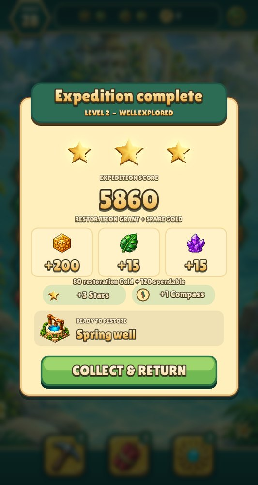
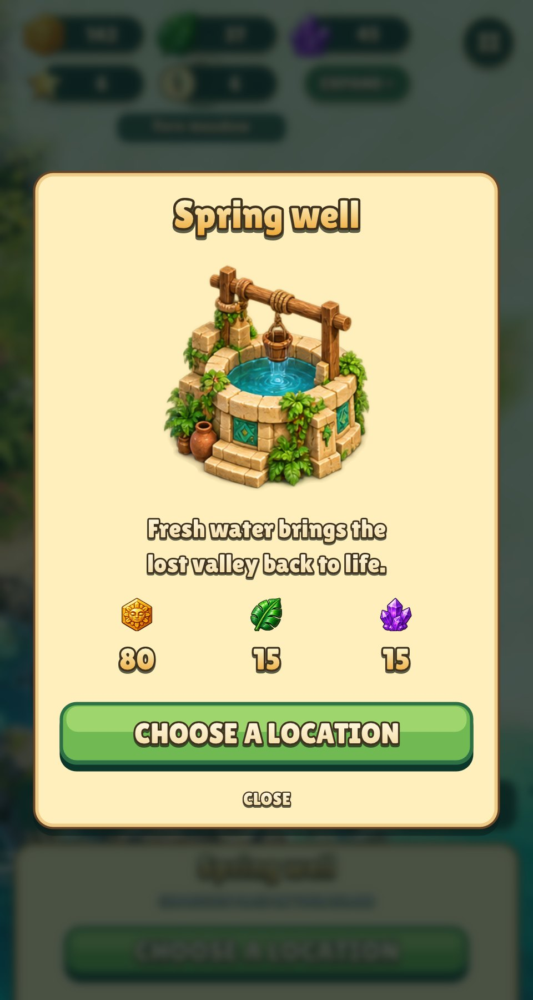

# UI typography and result screens

## Reference study

- [Gardenscapes: stars and garden renovation](https://playrix.helpshift.com/hc/en/5-gardenscapes/faq/61-what-are-stars/): the closest reference for the level → reward → restoration loop. Our Star/Compass economy remains its own implementation.
- [Homescapes: rewards](https://playrix.helpshift.com/hc/en/14-homescapes/faq/16357-getting-in-game-rewards/): completing puzzles and restoring areas are linked progression actions.
- [Playrix game portfolio](https://apps.apple.com/us/developer/playrix/id1162116447): Gardenscapes, Homescapes and Fishdom are presentation references for a focused reward, short labels and a clear continuation action.
- [Candy Crush: Sugar Stars](https://candycrush.zendesk.com/hc/en-us/articles/360002087578-How-do-I-collect-Sugar-Stars): a reference for animated star/reward presentation, not the source of our reward rules.
- [Material motion choreography](https://m1.material.io/motion/choreography.html): staggered reveals and continuity around a stable focal point.
- [FreeType glyph conventions](https://freetype.org/freetype2/docs/glyphs/glyphs-3.html): bearings, advances, baselines and visible bounds are distinct measurements.
- [SVG text anchoring](https://www.w3.org/TR/SVG/text.html): a reference for explicit start/middle/end placement semantics.

The visual interpretations above guide original Relic Rush components. No artwork or UI assets from these games are bundled.

## Typography defect and fix

The old shared-cell atlas was drawn directly into one image. Negative bearings allowed neighboring glyphs to enter adjacent cells: isolated-render comparisons identified contamination in `X` and `i`. The runtime then sampled every glyph's entire 80 × 96 cell, including those foreign pixels. It also centered a fixed padded texture rather than the actual visible ink.

The pipeline now renders each glyph on its own surface, packs it with gutters and exports its precise source rectangle, bearings and advance. The runtime samples only that rectangle, applies kerning and composites the complete string mask. Its actual nonzero ink bounds are retained separately from the shared outline, texture padding and drop shadow.

The result and wonder card layouts are pure functions of the viewport in `screens.lua`. Text is placed by its measured ink with the engine's `text_in`: it shrinks to fit an area and centring means the ink centre equals the area's centre. Buttons and circular counters use the same call, without per-label baseline corrections. The engine draws the shadow and outline layers behind the complete string, so one letter's border never covers another letter's fill.

Paragraphs use a cached balanced wrap layout, minimizing short orphan lines. The generated atlas remains Latin ASCII; full localized text shaping is outside this prototype.

## Result choreography

The result layout has named bounds shared by painting and input: header, stars, score, treasures, progress, next restoration and claim button.

1. The dimmer and card fade/raise into place.
2. Three actual star shapes appear with short staggered reveals.
3. The score counts up; resource cards follow in sequence.
4. The Star/Compass rewards and the next restoration become visible.
5. The primary button appears. A tap during the intro completes the reveal without collecting anything.
6. Collecting closes the card, then commits the reward exactly once and returns to the island.

There are no victory fireworks or confetti bursts. Two small torch sconces add localized warm light and continuous rising flame wisps. Reduced motion uses stable placement and a static flame pose.

Modal motion is a parent paint transform. It never changes SDL logical size or the mouse/touch coordinate conversion. `screens.lua` owns these components and transitions; the independent gameplay rules remain in `rules.lua`.

## Sprite extraction

Building sheet cells can contain a fragment of an adjacent painting. The asset pipeline keeps the dominant connected sprite component and a small antialias margin, removing the stray camp fragment beside the spring well. Original source paintings remain intact.

## Verification and captures

- Pure layout checks cover all nine anchor combinations, padding, fitting and component bounds.
- Every glyph's cell is checked for unexpected pixels outside its declared rectangle.
- Actual SDL pixel captures check centered ink for `i`, `X`, `j`, numerals, headings and long button labels.
- A modal regression verifies that skipping the reveal grants nothing and the animated claim commits once.
- Gameplay, six-size mouse/touch regression and the complete win → claim → build → next-level smoke flow pass.

The captures use demonstration progress, not a recorded player save. Generate them with `--victory --shot file.png` or `--card 1 --shot file.png`; `tools/screenshots.sh` also assembles the reel from `--victory --reel` frames. Stills show the settled state; reel frames run the actual entrance timeline. None writes player progress.
