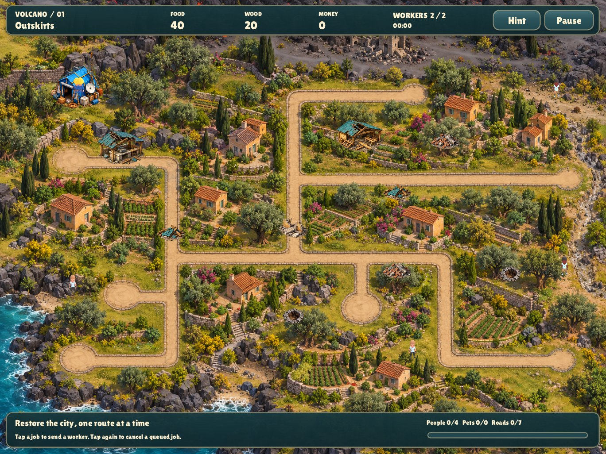

# Volcano · After the Eruption

The repository's third Lua game: a five-district rescue campaign on the shared
C/SDL engine. Reopen roads after an eruption, repair automatic supply stations,
recruit stranded workers and bring residents and pets back to headquarters.



Run from the repository root:

```sh
make run-volcano
make test
SDL_VIDEODRIVER=dummy SDL_AUDIODRIVER=dummy ./build/volcano --fresh --smoke --mute --size 456x342
```

Tap a job to assign a worker. A job without resources, an open route or a free
worker joins the queue; tap it again to cancel. Kitchens produce food, timber
yards produce wood and district offices produce money every five seconds.
Residents and stranded workers return automatically when their route opens.
Pets need a worker to escort them. Every damaged road is an objective.
Drag to pan; scroll or pinch to zoom. Pause freezes work and production.

| District | Roads | Stations | People, including recruits | Pets |
|---|---:|---:|---:|---:|
| Outskirts | 7 | 2 | 4 | 0 |
| Suburbs | 9 | 3 | 6 | 1 |
| Town Square | 11 | 3 | 8 | 1 |
| Cut-off District | 13 | 3 | 9 | 2 |
| City Centre | 16 | 3 | 11 | 2 |

Campaign unlocks, completion marks, best times, sound preferences and seen
briefings use the engine save visitor. Briefing name badges sit half outside the
visible bubble outline; text padding accounts for the rim and decorative shape. Active missions restart from their
initial state when the app is reopened; there is no mid-mission save.

The macOS and iPad schemes are `volcano-macos` and `volcano-ipad` in
`volcano.xcodeproj`. `make web` includes Volcano with the other games.
No source checkout, XML files, retail installation or asset importer is needed
to build or run the committed game.

Developer scene options:

```sh
./build/volcano --fresh --level 3 --shot square.png
./build/volcano --fresh --level 3 --preview repaired --shot repaired.png
./build/volcano --fresh --level 5 --preview complete --shot results.png
./build/volcano --fresh --level 1 --pause --shot pause.png
./build/volcano --fresh --level 1 --dialog --frames 180 --shot briefing.png
```

Preview stages play ordinary paid jobs through the simulation. The smoke test
uses actual injected clicks for jobs, pause/resume, restart, next district and
final replay; only time is accelerated.

See [the port assessment](docs/PORT.md), [asset replacements](docs/ASSETS.md),
[the machine-readable provenance catalog](docs/asset-catalog.json) and
[character attribution](docs/CHARACTERS.md).

All **11 authored missions**, their editable artwork, character models and original
tools are preserved in [source/](source/). The five campaign maps above are playable
in the new engine; the six earlier missions retain their original source format.
Original game references and local recovery backups live in the ignored root
`reference/` folder. See [the preservation inventory](docs/SOURCE-PRESERVATION.md).

To rebuild the campaign assets using only this repository's local files:

```sh
python3 games/volcano/tools/import_episode.py
python3 games/volcano/tools/preserve_source.py --verify
```
